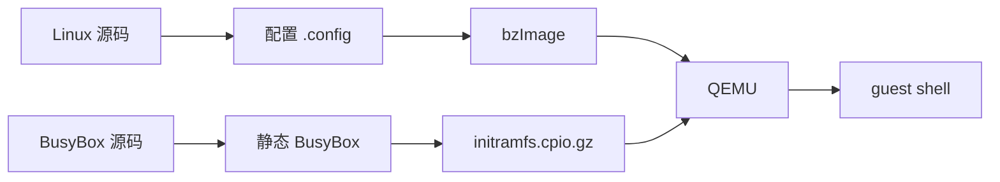
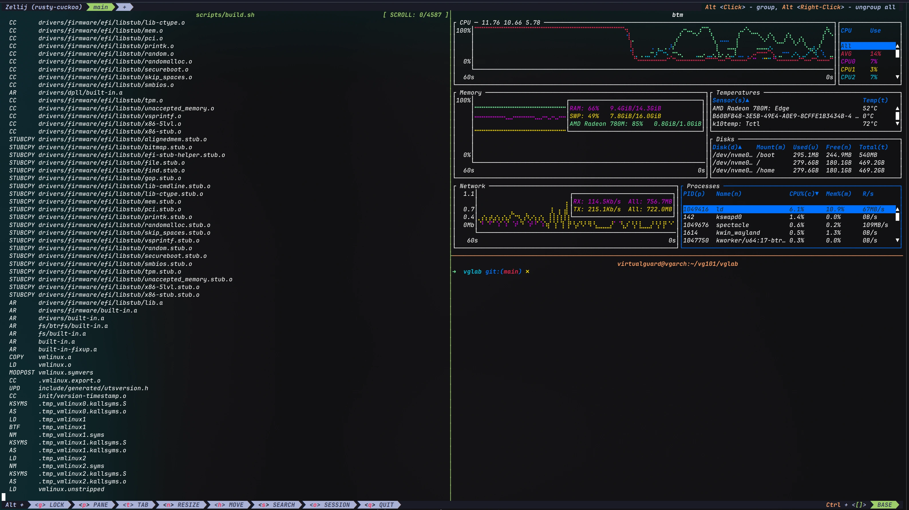
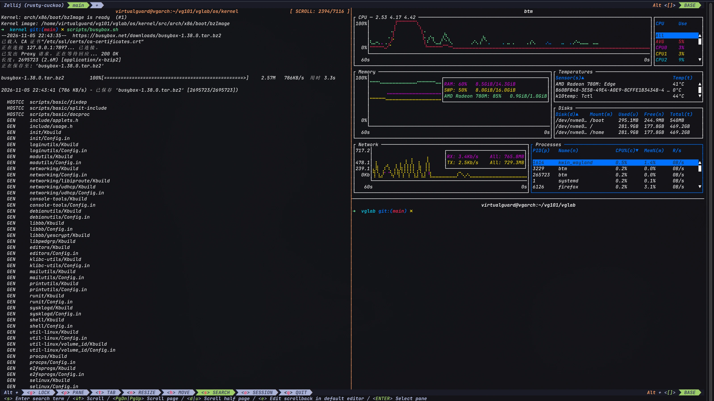
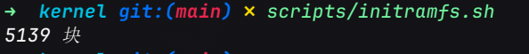
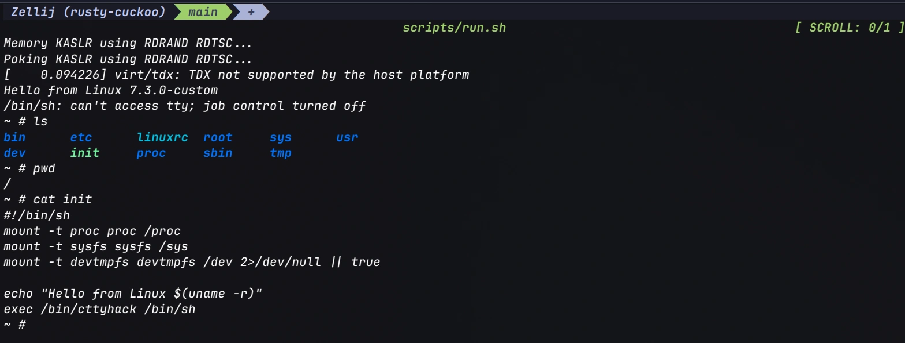

# 本地编译Linux内核

**在本地编译Linux内核是我一直想做但是因为各种原因没动手的事, 个人认为这是学习Linux内核的一个很好的入门方式. 本文记录一次 QEMU + BusyBox 的完整实验, 包括下载验签、配置、编译、制作 initramfs, 最后启动自己编译的内核.**

<!-- more -->

如果只是编译内核本身其实并不复杂. 下载源码、回答配置问题、执行 `make`, 再把生成的镜像交给引导器. 真正容易让人卡住的, 是这条链路上的每一环分别解决什么问题, 以及失败时问题的排查.

本文按一次完整的 QEMU 实验记录这个过程: 从 kernel.org 下载并验签源码, 生成面向虚拟机的 `.config`, 编译 `bzImage`, 用静态 BusyBox 制作 initramfs, 最后让 QEMU 直接启动这个内核.

相关实验脚本位于 [os/kernel | virtualguard101/vglab](https://github.com/virtualguard101/vglab/tree/main/os/kernel), 每一步对应一个脚本, 可以单独阅读和替换.

选择 QEMU 而不是直接装到宿主机的原因很简单, 编译错误最多让虚拟机起不来, 不会影响正在使用的系统.

## 手动编译内核的动机

从操作系统的视角看, 内核是唯一运行在内核态的代码, 负责把 CPU、内存、磁盘、网卡这些资源抽象成进程、虚拟地址空间、文件和 socket; 应用程序运行在用户态, 通过[系统调用](../../note/os/408/操作系统运行环境.md#系统调用)进入内核态请求服务.

发行版提供的内核, 就是这套代码经过发行版配置、打补丁和签名后的产物[^kernel]. 从更抽象的角度看, 操作系统也可以看成“对象 + API”, 内核实现这些对象和 API, 用户态程序再通过系统调用使用它们; 这个视角在[操作系统简易模型](../../note/os/intro/操作系统简易模型.md#应用视角下的操作系统)里有更完整的展开.

自己编译内核的意义大致有三类:

1. **学习**: 亲手走一遍“源码 -> 配置 -> 编译 -> 引导”的链路, 比只看书更容易建立整体图景.

2. **定制**: 裁剪不需要的驱动, 打开实验性选项, 保留调试符号, 或者修改启动参数和内核代码.

3. **开发**: 写内核模块、调驱动, 用 GDB 和 QEMU 跟踪启动过程.

需要区分“编译内核”和“安装一个 Linux 系统”. 内核只是系统的一部分; 没有 init、shell、libc 和基础工具, 内核启动后会因为找不到 `/init` 而 panic. 所以在 QEMU 实验里, 我们还要准备 BusyBox 作为最小用户态; 如果装到宿主机, 则继续使用发行版已有的用户态. 换句话说, 内核负责“管理资源”, 用户态负责“使用资源”, 两者通过系统调用连接起来; 关于内核态与用户态的划分, 可以看[这里](../../note/os/408/操作系统运行环境.md#内核态与用户态).

!!! info "完整 Linux 发行版从源码编译并安装"
    需要注意的是, 本文的"手动编译内核"和"手动编译安装一个成熟可用的Linux发行版"是两个完全不同的概念. 前者只需要短短几步就能生成内核镜像并进行仿真验证或写入物理机的引导器; 而后者则涉及完整的系统安装, 包括用户态工具链、包管理器、配置文件等, 是一个非常长且严谨的过程(通常需要花费数天时间), 适合深入学习.

    关于这块内容, 可以参考[Linux From Scratch (LFS)](https://www.linuxfromscratch.org/)

## 整体流程

从产物角度看, 整条链路是两条并行的构建线: 一条把内核源码变成 `bzImage`, 一条把 BusyBox 变成 initramfs, 最后在 QEMU 里汇合. 整个过程拆成 8 个可独立执行的步骤:



| 阶段 | 脚本 | 关键动作 | 主要产物 |
| --- | --- | --- | --- |
| 1 | `scripts/deps.sh` | 安装编译工具和 QEMU | 可用的工具链 |
| 2 | `scripts/getkernel.sh` | 下载内核并做 GPG 验签 | `linux-7.3.tar` |
| 3 | `scripts/extract.sh` | 解压源码 | `src/` |
| 4 | `scripts/config.sh` | 生成 QEMU 可用的配置 | `src/.config` |
| 5 | `scripts/build.sh` | 编译内核镜像 | `src/arch/x86/boot/bzImage` |
| 6 | `scripts/busybox.sh` | 编译静态 BusyBox | `busybox-install/` |
| 7 | `scripts/initramfs.sh` | 制作最小根文件系统 | `initramfs.cpio.gz` |
| 8 | `scripts/run.sh` | 在 QEMU 中启动内核 | 可交互的 guest shell |

下面按顺序展开每一步.

## 实验环境与依赖

我的实验环境是 Arch Linux x86_64, 编译的内核版本为 Linux 7.3, QEMU 使用 KVM 加速. 其他发行版的包名不同, 但步骤一致. 

首先安装工具链和依赖:

```bash
sudo pacman -S --needed qemu-system-x86 base-devel bc bison flex libelf \
    openssl ncurses cpio gzip wget xz bzip2 gnupg tar pahole python
```

各组依赖的用途如下:

| 软件包 | 用途 |
| --- | --- |
| `base-devel` | gcc、make、binutils 等宿主编译工具 |
| `bc`、`bison`、`flex`、`libelf`、`openssl`、`ncurses` | Kconfig 和内核构建依赖 |
| `python`、`pahole` | 内核构建脚本和 BTF 调试信息 |
| `cpio`、`gzip`、`xz`、`bzip2`、`tar` | 源码解压和 initramfs 打包 |
| `wget`、`gnupg` | 下载内核和验证签名 |
| `qemu-system-x86` | 启动虚拟机的 QEMU |

Ubuntu/Debian 的等价命令:

```bash
sudo apt install qemu-system-x86 build-essential bc bison flex libelf-dev \
    libssl-dev libncurses-dev cpio gzip wget xz-utils bzip2 gnupg tar \
    dwarves python3
```

如果要用 KVM 加速, 需先确认 `/dev/kvm` 存在并且当前用户有权限:

```bash
ls -l /dev/kvm
```

没有这个设备通常意味着 BIOS/UEFI 中没有开启虚拟化, 或者 `kvm` 模块没有加载. 没有 KVM 也能跑, 只是 QEMU 会退回纯软件模拟, 启动和交互都会慢很多; 这时把 `run.sh` 里的 `-enable-kvm -cpu host` 去掉即可.

## 获取并验证内核源码

内核源码从 [kernel.org](https://www.kernel.org/) 下载[^kernel-archive]. 版本号可以在首页看到; 学习和实验优先选 stable, 不要选 `-rc` 候选版. 以 7.3 为例, 需要同时下载压缩包和它的分离签名. 以下命令在 `os/kernel` 根目录执行:

```bash
VERSION=7.3
MAJOR=${VERSION%%.*}

wget "https://cdn.kernel.org/pub/linux/kernel/v${MAJOR}.x/linux-${VERSION}.tar.xz"
wget "https://cdn.kernel.org/pub/linux/kernel/v${MAJOR}.x/linux-${VERSION}.tar.sign"
```

`MAJOR=${VERSION%%.*}` 会取出 `7`, 因此 URL 指向 `v7.x/`. 换版本时只需要改 `VERSION`.

### 签名验证

内核发布的 `.tar.sign` 是对未压缩的 `.tar` 做的分离签名, 不是对 `.tar.xz` 的签名[^kernel-sign]. 所以验证前要先解压, 但可以保留原来的 `.xz`:

```bash
unxz -k "linux-${VERSION}.tar.xz"

KEYID=$(gpg --list-packets "linux-${VERSION}.tar.sign" \
    | grep -i keyid | awk '{print $NF}')
gpg --recv-keys "$KEYID"
gpg --verify "linux-${VERSION}.tar.sign" "linux-${VERSION}.tar"
```

`gpg --list-packets` 从签名文件里读出签名者的 key ID, `--recv-keys` 再把这个公钥导入本地 keyring. 如果 keyserver 访问不畅, 可以改用 kernel.org 文档推荐的 WKD 方式:

```bash
gpg --locate-keys torvalds@kernel.org gregkh@kernel.org
```

看到 `Good signature` 说明 tarball 没有被篡改. GPG 可能同时提示 “This key is not certified with a trusted signature”, 这是信任模型的问题, 不影响完整性校验; 确认 key 的指纹来自 kernel.org 即可.

!!! info "为什么验证的是 .tar, 而不是 .tar.xz"
    压缩只是传输层的外壳, 同一个 tar 可以用 gzip、xz、zstd 压成不同字节流; 对压缩包签名, 解压方式一变签名就对不上. kernel.org 选择对未压缩的 tar 签名, 验证时再解压, 这样签名和压缩格式解耦. 代价是本地要多占一份磁盘空间, 但换来的是更稳定的校验方式.

### 解压内核源码

```bash
mkdir -p src
tar -xf linux-7.3.tar -C src --strip-components=1
```

`--strip-components=1` 会去掉压缩包顶层的 `linux-7.3/` 目录, 让内核源码直接落在 `src/`. 后面的脚本都以 `src/` 为工作目录, 这样路径更短, 也方便把源码树整体删除.

如果复用的是已经编译过的源码树, 先执行 `make mrproper` 清理旧配置和产物; 这次是刚解压的干净源码, 可以跳过.

## 配置内核

配置是整个流程里最容易被低估的一步.

内核有几万个配置项, 它们决定哪些代码被编进镜像、哪些编成模块、哪些完全不编译. 这些选项由 Kconfig 描述, `make *config` 系列命令负责把它们解析成最终的 `.config`[^kconfig]. `menuconfig` 只是前端, 真正的产物始终是 `.config`.

### 配置从哪里来

从零回答几万个问题不现实, 所以 `config.sh` 按下面的顺序生成配置. 实际使用时, 在 `os/kernel` 根目录执行 `scripts/config.sh` 即可; 下面展开它的关键步骤, 命令实际都在 `src/` 目录执行:

```bash
# 1. 以当前运行内核的配置为基线
zcat /proc/config.gz > .config
# Ubuntu/Debian: cp "/boot/config-$(uname -r)" .config

# 2. 补全新版本内核新增的选项
make olddefconfig

# 3. 合并上游的 KVM guest 配置片段
make kvm_guest.config

# 4. 强制打开这次启动必需的选项
./scripts/config \
    --enable BLK_DEV_INITRD --enable RD_GZIP \
    --enable DEVTMPFS --enable DEVTMPFS_MOUNT --enable TMPFS \
    --enable PROC_FS --enable SYSFS \
    --enable TTY --enable SERIAL_8250 --enable SERIAL_8250_CONSOLE \
    --enable EARLY_PRINTK \
    --enable BINFMT_ELF --enable BINFMT_SCRIPT --enable UNIX98_PTYS \
    --enable VIRTIO_PCI --enable VIRTIO_BLK --enable VIRTIO_NET \
    --enable VIRTIO_CONSOLE --enable HW_RANDOM_VIRTIO

# 5. 保留调试信息, 方便之后用 GDB 看 vmlinux
./scripts/config --disable DEBUG_INFO_NONE \
    --disable DEBUG_INFO_DWARF4 --disable DEBUG_INFO_DWARF5 \
    --enable DEBUG_INFO_DWARF_TOOLCHAIN_DEFAULT

# 6. 固定版本号, 并关闭“警告即错误”
./scripts/config --set-str LOCALVERSION "-custom" \
    --disable LOCALVERSION_AUTO --disable WERROR

# 7. 让上面的修改通过 Kconfig 依赖检查
make olddefconfig
```

这里有几个关键点:

- **以宿主配置为基线**: `/proc/config.gz` 是当前 Arch 内核的配置, 保留了这台机器实际需要的驱动. 如果直接 `make defconfig`, 得到的是一个通用配置, 很多驱动还是以模块形式存在; 这次只编译 `bzImage`, 不编译模块, 启动时同样用不上.

- **`olddefconfig` 不是 `oldconfig`**: `oldconfig` 会逐个询问新增选项, `olddefconfig` 则直接采用默认值, 适合脚本化构建.

- **`kvm_guest.config` 补充虚拟化设备**: 这个上游配置片段会打开 virtio 块设备、网卡、控制台、9p 共享目录、KVM guest 支持和半虚拟化相关选项. 它解决的是“内核能在 QEMU 里跑”的问题.

- **必须内置而不是模块**: 这次只编译 `bzImage`, 不编译也不安装模块. 因此 initramfs、串口、devtmpfs、proc/sysfs 以及 virtio 这些启动路径上的驱动必须写成 `=y`; 如果它们还是 `=m`, 内核启动时根本加载不到对应的 `.ko`.

!!! tip
    用一个不太严谨的比喻: 配置内核像给一次组装下单, `=y` 是把零件直接焊在板子上, `=m` 是放进工具箱、启动后再按需加载, `n` 是根本不买. 这次我们只编译 `bzImage`, 没有准备工具箱, 所以启动路径上的零件必须焊死. 模块是 `.ko` 文件, 通常放在 `/lib/modules/<version>/`, 由 `udev` 或 `modprobe` 在用户态加载; initramfs 里既没有这些工具, 也没有模块文件, 所以不能依赖 `=m`.

如果不想依赖宿主配置, 也可以从 `make defconfig` + `make kvm_guest.config` 起步; 对纯 QEMU 实验通常够用, 但同样要把启动路径上的驱动改成 `=y`.

几个强制选项的作用可以对照下表:

| 选项 | 作用 | 不开的后果 |
| --- | --- | --- |
| `BLK_DEV_INITRD`、`RD_GZIP` | 支持加载 gzip 压缩的 initramfs | QEMU 传入的 initrd 被忽略, 内核找不到根文件系统 |
| `DEVTMPFS`、`DEVTMPFS_MOUNT` | 内核自动挂载 devtmpfs, 提供 `/dev/console` | `/init` 运行时没有设备节点 |
| `TMPFS`、`PROC_FS`、`SYSFS` | 提供 `/proc`、`/sys` 等基础文件系统 | BusyBox 的 `mount` 和许多命令无法工作 |
| `TTY`、`SERIAL_8250`、`SERIAL_8250_CONSOLE`、`EARLY_PRINTK` | 8250 串口控制台, 把日志送到 `ttyS0` | `-nographic` 下看不到启动日志 |
| `BINFMT_ELF`、`BINFMT_SCRIPT` | 执行 ELF 格式的 BusyBox 和 `#!/bin/sh` 的 `/init` | `No working init found` |
| `VIRTIO_PCI`、`VIRTIO_BLK`、`VIRTIO_NET`、`VIRTIO_CONSOLE` | QEMU 的 virtio 虚拟设备 | 后续挂磁盘、网卡或串口设备不可用 |

### 版本号与调试信息

`LOCALVERSION="-custom"` 会让 `uname -r` 输出 `7.3.0-custom`, 而不是和发行版内核相同的版本号. 这是一个很小的改动, 但很重要: 安装到宿主机时, 它能避免覆盖发行版内核的 `/lib/modules` 和 `/boot` 文件.

`DEBUG_INFO_DWARF_TOOLCHAIN_DEFAULT` 保留 DWARF 调试信息. 代价是 `vmlinux` 会变得很大(本次约 487 MB), 但 `bzImage` 仍然只有约 17 MB. 如果只关心“能不能启动”, 可以删掉这几行, 编译会更快, 镜像也更小; 需要 GDB 调试时再打开.

`WERROR` 关闭后, 编译器警告不会直接中断构建. 对非发行版同款工具链来说, 这能减少很多“因为一个新警告导致编译失败”的麻烦.

配置完成后, 可以备份 `.config`, 也可以进入交互界面微调:

```bash
cp .config ~/config-7.3.0-custom
make menuconfig
```

想更彻底地理解每个配置项, 可以在跑通后尝试 `make allnoconfig`, 再逐个打开 initramfs、串口、devtmpfs、proc/sysfs 和 `BINFMT_SCRIPT`. 这条路径更容易漏项, 适合作为深入学习内核配置的方式.

## 编译内核



```bash
cd src   # 如果当前已经在 src/, 可以跳过
make -j"$(nproc)" bzImage
```

`-j"$(nproc)"` 让 make 按 CPU 逻辑核心数并行编译. 内存较小的机器可以改成 `-j"$(($(nproc)/2))"`, 否则并行编译可能因为内存不足被 OOM killer 终止.

编译完成后, 关键产物有三个:

| 文件 | 内容 |
| --- | --- |
| `vmlinux` | 未压缩的 ELF 内核, 带符号和调试信息, 主要给 GDB 用 |
| `arch/x86/boot/bzImage` | 压缩后的可引导镜像, QEMU 或引导器实际加载的文件 |
| `System.map` | 符号地址表, 调试和排查 panic 时有用 |

!!! info "vmlinux 与 bzImage"
    `vmlinux` 是链接后的 ELF 文件, 包含符号和调试信息, 主要给 GDB 用.
    
    `bzImage` 则在 `vmlinux` 的基础上压缩, 并加上自解压头. 引导器实际加载的是 `bzImage`, 内核启动时先把自己解压到内存, 再进入 `start_kernel()`. `bzImage` 里的 `bz` 是“big zImage”的意思, 它把压缩后的内核放在 1 MB 以上的内存位置, 适合现代 x86 机器[^x86-boot]. 如果想了解 ELF 的装入过程, 可以看[可执行文件](../../note/os/可执行文件.md#ELF的装入与启动).

本次编译的收尾输出如下, 看到 `Kernel: arch/x86/boot/bzImage is ready` 就说明镜像已经生成:

编译时间取决于 CPU 核心数、内存和配置规模, 从十几分钟到数小时都有可能. 本次开启了 DWARF 调试信息, 所以 `vmlinux` 很大, 但真正传给 QEMU 的 `bzImage` 只有 17 MB.

## 使用BusyBox构建最小用户态

内核启动到最后会尝试执行用户态的第一个进程. 它会按 `/init`、`/sbin/init`、`/bin/sh` 等路径依次寻找可执行文件; 如果这些都找不到, 内核会打印 `No working init found` 并 panic. 因此还需要一个最小用户态.

[BusyBox](https://busybox.net/about.html) 把 `sh`、`ls`、`cat`、`mount`、`uname` 等常用工具塞进一个可执行文件, 常被称为“嵌入式 Linux 的瑞士军刀”[^busybox]. 对 initramfs 来说, 它刚好够用. 先回到 `os/kernel` 根目录(从 `src/` 执行 `cd ..`), 然后:

```bash
wget https://busybox.net/downloads/busybox-1.38.0.tar.bz2
tar -xf busybox-1.38.0.tar.bz2
cd busybox-1.38.0

make defconfig

# initramfs 中没有 libc 和动态链接器, 必须静态链接
sed -i 's/^# CONFIG_STATIC is not set/CONFIG_STATIC=y/' .config

# 当前内核头文件删除了 CBQ uapi, BusyBox 的 tc 无法编译
sed -i 's/^CONFIG_TC=y/# CONFIG_TC is not set/' .config

make -j"$(nproc)"
make CONFIG_PREFIX="$PWD/../busybox-install" install
```



`CONFIG_STATIC=y` 是这里最关键的设置. ELF 可执行文件分静态链接和动态链接: 动态链接的 ELF 在程序头表里记录了一个 `PT_INTERP`, 告诉内核先加载 `ld-linux-x86-64.so.2`, 再由它加载 libc; initramfs 里没有这些文件, `execve()` 找不到解释器, 就会返回 `ENOENT`, 表现成一句很难看懂的 `not found`. 静态链接把 libc 一起放进二进制, 问题就消失了. 关于 ELF 的段、程序头和装入过程, 可以看[可执行文件](../../note/os/可执行文件.md#ELF的装入与启动).

`tc` 的问题来自版本错位: BusyBox 1.38.0 的 `tc` 还在引用旧的内核 CBQ uapi, 而当前内核头文件已经把它删掉了. initramfs 不需要流量控制工具, 直接关闭这个 applet 即可, 不影响其他命令.

`make install` 会在 `busybox-install/` 下生成 `bin/busybox` 以及大量指向它的符号链接. 这个目录就是后面 initramfs 的用户态骨架.

## 制作initramfs

initramfs 是一个 gzip 压缩的 cpio 归档. 内核启动时把它解压到 rootfs(基于 ramfs/tmpfs 的内存文件系统), 然后执行其中的 `/init`[^initramfs]. 它和早期的 initrd 不同: initrd 是一个独立的块设备镜像, 需要内核先有对应的文件系统驱动; initramfs 则是直接链接进启动流程的 cpio 归档, 更简单, 也更适合最小系统.

制作过程只有三步: 建目录、放 BusyBox 和 `/init`、打包. 先回到 `os/kernel` 根目录(从 `busybox-1.38.0` 执行 `cd ..`), 然后:

```bash
rm -rf initramfs
mkdir -p initramfs/{bin,sbin,etc,proc,sys,dev,tmp}
cp -a busybox-install/. initramfs/

cat > initramfs/init <<'EOF'
#!/bin/sh
mount -t proc proc /proc
mount -t sysfs sysfs /sys
mount -t devtmpfs devtmpfs /dev 2>/dev/null || true

echo "Hello from Linux $(uname -r)"
exec /bin/cttyhack /bin/sh
EOF

chmod +x initramfs/init

cd initramfs
find . | cpio -o -H newc | gzip -9 > ../initramfs.cpio.gz
```

`/init` 是内核创建的第一个用户态进程, PID 为 1. 它和普通进程不同: 内核不会像对待普通进程那样把它杀死; 如果 PID 1 退出, 内核会 panic. 所以 `/init` 通常用 `exec` 把自己替换成 shell, 让 shell 继续以 PID 1 运行. `exec` 不会创建新进程, 它只是把当前进程的地址空间替换成新程序, PID 保持不变. 关于进程状态和进程控制, 可以看[进程的描述与控制](../../note/os/408/进程的描述与控制.md).

!!! note "PID 1 的特殊性"
    PID 1 是内核创建的第一个用户态进程, 负责收孤儿进程、处理信号等. 普通进程退出只是被父进程回收; PID 1 退出则意味着用户态没有可调度的初始进程, 内核会 panic 或重启. 这也是为什么容器里的 PID 1 需要特别处理 `SIGTERM`.

`cttyhack` 是 BusyBox 的一个小工具, 用来给 shell 绑定控制终端. 在这个最小串口控制台里, 仍然可能看到 `/bin/sh: can't access tty; job control turned off` 的提示. 它只影响 Ctrl-C、Ctrl-Z 这类作业控制, 不影响命令执行, 可以忽略.

`find . | cpio -o -H newc` 里的 `newc` 是内核 initramfs 解包器支持的 cpio 格式; `gzip -9` 再压缩一层. 打包完成后, `initramfs.cpio.gz` 大约 1.3 MB:



截图里的 `5139 块` 是 cpio 报告的归档块数.

!!! info "真实发行版的 initramfs"
    真实发行版的 initramfs 通常更复杂. 它会带 udev、存储控制器、LUKS/LVM 等模块, 先挂载真正的根分区, 再用 `switch_root` 切换到磁盘上的根文件系统; 我们这里没有磁盘, 所以 `/init` 直接 exec 一个 shell. 关于文件系统和根目录的概念, 可以看[文件系统概述](../../note/os/408/文件系统概述.md).

## 使用QEMU启动

回到 `os/kernel` 根目录(从 `initramfs/` 执行 `cd ..`), 现在可以把内核和 initramfs 交给 QEMU 了:

```bash
qemu-system-x86_64 \
    -kernel src/arch/x86/boot/bzImage \
    -initrd initramfs.cpio.gz \
    -append "console=ttyS0 earlyprintk=serial devtmpfs.mount=1" \
    -nographic \
    -m 512M \
    -enable-kvm -cpu host
```

!!! info "QEMU 为什么能直接启动内核"
    QEMU 的 `-kernel` 走的是 x86 boot protocol: 它把 `bzImage` 放到 guest 内存, 填好 `boot_params`, 把 initrd 的地址和大小写进去, 然后跳到内核入口. 内核先解压自己, 进入 `start_kernel()`, 初始化内存管理、中断和调度器, 最后解包 initramfs 并执行 `/init`[^x86-boot]. 所以这里不需要 GRUB, QEMU 自己扮演了引导器的角色.

各参数的作用:

| 参数 | 作用 |
| --- | --- |
| `-kernel` | 让 QEMU 直接加载 `bzImage`, 跳过 GRUB/UEFI 引导阶段 |
| `-initrd` | 把 initramfs 交给内核, 内核启动时解压到 rootfs |
| `-append` | 传递内核命令行: 串口控制台、早期打印、自动挂载 devtmpfs |
| `-nographic` | 不创建图形窗口, 把串口和 QEMU monitor 复用到当前终端 |
| `-m 512M` | 给 guest 分配 512 MB 内存 |
| `-enable-kvm -cpu host` | 使用 KVM 硬件加速, 并把宿主 CPU 特性暴露给 guest |

QEMU 在这里充当了引导器: `-kernel` 让它直接把内核镜像装进 guest 内存, 不需要先做一块可启动磁盘[^qemu-linuxboot]. 这正是它适合内核实验的原因, 改完配置重新编译后, 一条命令就能重启验证.

启动后的典型输出:



```text
Memory KASLR using RDRAND RDTSC...
Poking KASLR using RDRAND RDTSC...
[    0.094226] virt/tdx: TDX not supported by the host platform
Hello from Linux 7.3.0-custom
/bin/sh: can't access tty; job control turned off
~ # uname -r
7.3.0-custom
~ # ls
bin   dev   etc   init   linuxrc   proc   root   sbin   sys   tmp   usr
```

`virt/tdx: TDX not supported by the host platform` 是 guest 内核在探测 Intel TDX 虚拟化特性, 宿主不支持时打印的提示, 不影响启动. `can't access tty` 的问题前面已经解释过, 同样可以忽略.

进入 shell 后可以确认几件事:

```bash
uname -r          # 7.3.0-custom, 说明运行的是自己编译的内核
cat /proc/cmdline # 查看 QEMU 传入的命令行
ls /dev           # devtmpfs 已经挂载, 能看到 console、null 等设备
cat init          # 查看 initramfs 里的 /init
```

退出 QEMU 的方法是先按 `Ctrl-A`, 再按 `X`; 如果想切到 QEMU monitor, 按 `Ctrl-A`, 再按 `C`[^qemu-invocation].

## 安装到宿主机

QEMU 实验跑通后, 如果要把内核装进真实系统, 流程会多出“安装模块”和“更新引导”两步. 这里只给出 Arch Linux 的思路, 其他发行版的细节可以查对应文档[^kernel-build]. 下面假设当前位于 `src/` 目录, 并且已经用 `config.sh` 生成了配置.

!!! warning "不要直接装到唯一的生产系统"
    安装自定义内核会修改 `/boot` 和 `/lib/modules`. 至少保留一个可启动的旧内核, 并确认自己能在引导菜单里选择它. 第一次试验建议在虚拟机或有完整备份的机器上进行.

### 1. 编译并安装模块

宿主机内核通常需要模块, 所以不能只编译 `bzImage`:

```bash
make -j"$(nproc)"
sudo make modules_install
```

模块会被安装到 `/lib/modules/7.3.0-custom/`. 如果之前只跑了 `make bzImage`, 需要重新执行一次完整的 `make`, 否则 `modules_install` 没有东西可装.

### 2. 复制内核和元数据

```bash
sudo cp arch/x86/boot/bzImage /boot/vmlinuz-7.3.0-custom
sudo cp System.map /boot/System.map-7.3.0-custom
sudo cp .config /boot/config-7.3.0-custom
```

`LOCALVERSION="-custom"` 让这些文件名和发行版内核区分开, 不会覆盖 `/boot/vmlinuz-linux`. 有些发行版的 `make install` 会自动完成复制并调用 `installkernel`; ArchWiki 的传统编译流程则更倾向手动复制[^kernel-build]. 两种方式都可以, 关键是确认最终文件名和引导项一致.

### 3. 生成 initramfs

Arch 用 `mkinitcpio` 生成 initramfs. 可以直接指定内核版本:

```bash
sudo mkinitcpio -k 7.3.0-custom -g /boot/initramfs-7.3.0-custom.img
```

也可以复制一份 preset 再改:

```bash
sudo cp /etc/mkinitcpio.d/linux.preset /etc/mkinitcpio.d/linux-custom.preset
# 编辑 ALL_kver、default_image 和 fallback_image
sudo mkinitcpio -p linux-custom
```

`mkinitcpio` 会从 `/lib/modules/7.3.0-custom/` 读取模块, 所以上一步的 `modules_install` 不能漏. 真实系统的 initramfs 还要负责加载根分区所需的存储、加密和文件系统模块, 这也是它和前面那个 1.3 MB 最小 initramfs 最大的区别.

### 4. 更新引导器

GRUB 用户重新生成配置:

```bash
sudo grub-mkconfig -o /boot/grub/grub.cfg
```

systemd-boot 用户需要在 `/boot/loader/entries/` 下新增一个条目, 指向新的 `vmlinuz` 和 `initramfs`, 并在 `options` 里保留原来的 `root=` 和内核参数:

```text
title   Arch Linux (7.3.0-custom)
linux   /vmlinuz-7.3.0-custom
initrd  /initramfs-7.3.0-custom.img
options root=PARTUUID=... rw
```

重启后选择新内核, 用 `uname -r` 确认. 如果启动失败, 在引导菜单里选回旧内核, 然后删除 `/boot/vmlinuz-7.3.0-custom`、`/boot/initramfs-7.3.0-custom.img`、`/boot/System.map-7.3.0-custom`、`/lib/modules/7.3.0-custom/`, 再更新一次引导器即可.

### 物理硬件的注意事项

- **保留宿主配置**: 脚本已经从 `/proc/config.gz` 起步, 这能保留存储控制器、文件系统、显卡等驱动.

- **不要只编译 `bzImage`**: 真实硬件往往需要模块, 必须 `make` + `make modules_install`.

- **注意 initramfs 内容**: 如果根文件系统在 LUKS、LVM、RAID 或特殊控制器上, 确保对应的模块和 hook 已经进入 initramfs.

- **外部模块要重编**: NVIDIA 驱动、VirtualBox Guest Additions 等第三方模块需要针对新内核重新编译.

- **`make localmodconfig` 要谨慎**: 它只保留当前已加载的模块, 能显著缩小配置, 但可能漏掉启动时才需要的驱动. 在目标机上运行, 并先插好常用外设.

## 常见问题

| 现象 | 可能原因 | 处理 |
| --- | --- | --- |
| `bc: command not found` 或 `flex: not found` | 依赖没有装齐 | 重新执行 `scripts/deps.sh` |
| BusyBox 编译在 `tc.c` 报错 | 内核头文件删除了 CBQ uapi | 关闭 `CONFIG_TC`, 脚本已经处理 |
| `Could not access KVM kernel module` | 没有 `/dev/kvm` 或权限不足 | 开启虚拟化、加载 `kvm` 模块, 或去掉 `-enable-kvm -cpu host` |
| `Kernel panic - not syncing: No working init found` | `/init` 及回退的 init 路径都不可执行, 或 `BINFMT_SCRIPT` 没开 | 检查 initramfs 内容和配置 |
| `can't access tty; job control turned off` | 最小串口控制台没有控制终端 | 可以忽略, 不影响命令执行 |
| `-nographic` 下没有任何输出 | 没有指定 `console=ttyS0` | 在 `-append` 中加 `console=ttyS0 earlyprintk=serial` |
| `initramfs unpacking failed` | cpio 格式不对或压缩方式不支持 | 使用 `cpio -H newc` 和 gzip, 确认 `RD_GZIP=y` |
| GPG 报 `No public key` | 签名者公钥没有导入 | 用 `gpg --locate-keys` 或 `--recv-keys` 导入 |
| 宿主机启动黑屏 | 缺少显卡、存储或文件系统驱动 | 用旧内核启动, 回到宿主配置重新裁剪 |

## Begin From Here

!!! abstract
    1. **配置决定内核里有什么**: `.config` 不只是开关集合, 它决定了哪些驱动是 built-in、哪些是模块、哪些根本不参与编译. 只编译 `bzImage` 时, 启动路径上的驱动必须是 built-in.

    2. **initramfs 是内核和用户态之间的桥**: 内核本身不会打印 shell 提示符; 它需要找到 `/init`, 而 `/init` 需要一个可执行的用户态. BusyBox 静态链接的意义就在这里.

    3. **QEMU 把引导链缩短了**: `-kernel` 跳过 bootloader, 让“改配置 -> 重编译 -> 启动验证”的循环变得非常快, 也让失败的成本降到接近零.

对于深入学习Linux与操作系统原理, 尝试手动编译内核只是开始.

接下来可以尝试以下几个方向:

- **GDB 调试内核**: 在 QEMU 命令中加 `-s -S`, 然后在另一个终端运行 `gdb src/vmlinux`, 执行 `target remote :1234`; 断点设好后用 `continue` 让内核继续启动.

- **9p 共享目录**: 给 QEMU 加 `-virtfs local,path=$PWD/share,mount_tag=host0,security_model=none`, 在 guest 中 `mount -t 9p -o trans=virtio host0 /mnt`. 配置里已经打开了 `NET_9P` 和 `9P_FS`.

- **磁盘根文件系统**: 制作一个 ext4 镜像, 用 `-drive` 挂成 virtio 块设备, 把 `root=/dev/vda` 传给内核, 这会更接近真实系统的启动方式.

- **写一个内核模块**: 从最简单的 `hello world` 开始, 用 `insmod`/`rmmod` 观察模块的加载和卸载.

- **系统学习内核和驱动开发**: 想系统学习内核和驱动开发, Bootlin 的培训材料也值得读[^bootlin].


[^kernel]: [内核 | ArchWiki(CN)](https://wiki.archlinuxcn.org/wiki/%E5%86%85%E6%A0%B8)

[^kernel-archive]: [The Linux Kernel Archives](https://www.kernel.org/)

[^kernel-sign]: [Verifying kernel signatures | kernel.org](https://www.kernel.org/signature.html)

[^kconfig]: [Kconfig Language | The Linux Kernel documentation](https://docs.kernel.org/kbuild/kconfig.html)

[^x86-boot]: [The x86 boot protocol | The Linux Kernel documentation](https://docs.kernel.org/arch/x86/boot.html)

[^busybox]: [About BusyBox](https://busybox.net/about.html)

[^initramfs]: [Ramfs, rootfs and initramfs | The Linux Kernel documentation](https://docs.kernel.org/filesystems/ramfs-rootfs-initramfs.html)

[^qemu-linuxboot]: [Linux direct boot | QEMU documentation](https://www.qemu.org/docs/master/system/linuxboot.html)

[^qemu-invocation]: [Invocation | QEMU documentation](https://www.qemu.org/docs/master/system/invocation.html)

[^kernel-build]: [内核/传统编译 | ArchWiki(CN)](https://wiki.archlinuxcn.org/wiki/%E5%86%85%E6%A0%B8/%E4%BC%A0%E7%BB%9F%E7%BC%96%E8%AF%91)

[^bootlin]: [Training materials | Bootlin](https://bootlin.com/docs/)
