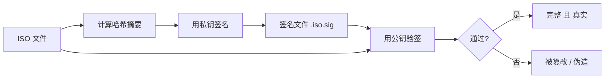
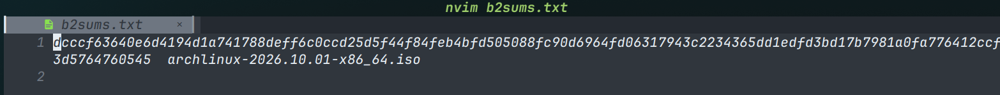
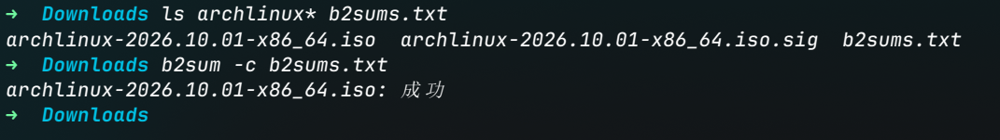
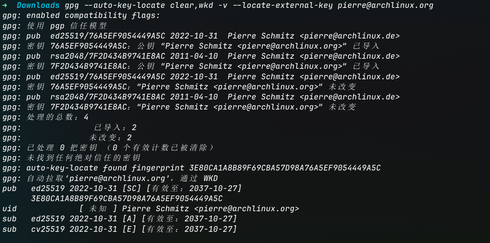
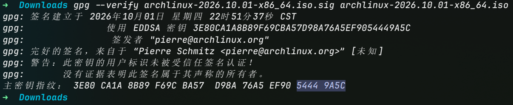
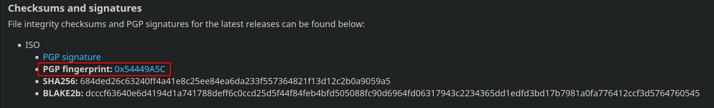
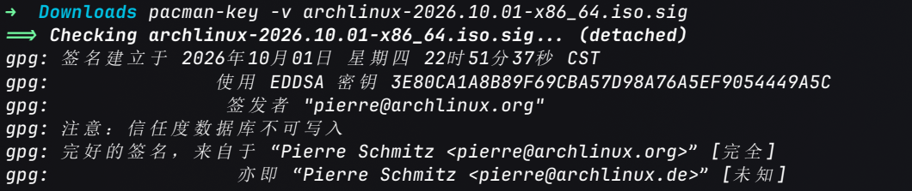

# 数字签名

> [Installation guide | Arch Wiki](https://wiki.archlinux.org/title/Installation_guide) - 官方安装指南, 含 "Verify signature" 一节
>
> [Public-key cryptography | Wikipedia](https://en.wikipedia.org/wiki/Public-key_cryptography) - 非对称加密与公钥认证的原理
>
> [GnuPG](https://gnupg.org/) / [Sequoia PGP](https://sequoia-pgp.org/) - 两个 PGP 签名/验签工具
>
> [Arch Linux 开发者名单](https://archlinux.org/people/developers/) - 用于核对签名密钥指纹


**数字签名** (digital signature) 是一种基于[非对称加密](https://en.wikipedia.org/wiki/Public-key_cryptography)的技术, 用来同时保证一段数据的**完整性** (内容没被篡改) 与**真实性** (确实出自声称的发布者之手). 下载操作系统镜像、安装软件包、验证 HTTPS 证书时, 背后的校验都依赖它.

以 [Arch Linux 镜像](https://archlinux.org/download/) 的下载与校验为例: 官方除了提供 `archlinux-*.iso` 本体, 还额外提供两类用于校验的文件: **校验和** (`sha256sums.txt` / `b2sums.txt`) 与 **PGP 签名** (`*.iso.sig`). 前者只能验证"文件是否完整", 后者才能同时验证"文件是谁发布的". 理解这两者的区别, 就是理解数字签名的核心.

## 校验和

**哈希** (hash, 又称**摘要** digest) 是把任意长度的数据映射成一段固定长度"指纹"的单向函数, 常见的有 SHA-256、BLAKE2b 等. 同一份文件算出的哈希一定相同; 文件哪怕只改动一个字节, 哈希就会完全不同.

官方发布的 `sha256sums.txt` / `b2sums.txt` 里, 记录的正是 ISO 文件的哈希值. 下载后本地重新算一遍再比对, 就能确认文件在传输中没有损坏:

```bash
b2sum -c b2sums.txt
# 或
sha256sum -c sha256sums.txt
```

校验和能回答的问题是: **"这份文件和我预期的是不是一模一样?"** 但它回答不了: **"这份文件到底是不是官方发布的?"**

原因在于, 如果攻击者能在传输途中拦截并替换 ISO (例如 HTTP 明文镜像被中间人劫持), 那么他完全可以同时伪造一份 `sha256sums.txt` 放进去. 校验和与文件同源同信道, 一起被换掉之后, 比对依然"通过".

!!! tip
    哈希好比**密封袋上的封条**——它能告诉你东西被动过, 但封条本身也能被撕下来换一张新的, 你无从分辨封条是不是原厂的.

## 数字签名

数字签名用[非对称加密](https://en.wikipedia.org/wiki/Public-key_cryptography) (公钥/私钥) 补上了校验和机制的这个缺口. 非对称加密有一对密钥:

- **私钥** (private key): 只有发布者自己持有, 严格保密, 用来**签名**.

- **公钥** (public key): 公开给所有人, 用来**验签**.

签名的流程大致是:

1. 发布者对 ISO 算出哈希摘要.

2. 发布者用**私钥**对摘要做一次签名运算, 得到**签名** (即 `*.iso.sig` 文件的内容).

3. 用户下载 ISO 和签名后, 用发布者公开的**公钥**验证签名: 签名有效 ⟺ 文件确实被持有对应私钥的人签过, 且内容未被改动.



因为私钥只有发布者持有、且无法从公钥反推出来, 所以**攻击者即便能偷换 ISO, 也无法伪造一个能通过验签的签名**. 这一步同时保证了:

| 性质 | 含义 | 由谁保证 |
|:---|:---|:---|
| 完整性 | 文件内容没被篡改 | 哈希摘要 |
| 真实性 | 文件确实来自发布者 | 私钥签名 |
| 不可否认性 | 发布者无法事后抵赖"不是我签的" | 私钥唯一性 |

仍然用印章来类比: 数字签名相当于发布者在文件上**盖了一枚只有他本人持有的私章**; 公钥则是这枚章的**公开印样**——任何人都能拿印样去比对, 但没人能照着印样伪造出原章.

!!! info
    RSA 签名可粗略理解为"用私钥加密摘要", 而 Ed25519、ECDSA 等现代算法使用专门的签名运算, 并不直接等价于加密.

## 公钥的分发

到这里还剩最后一个问题: 用来验签的那把公钥, 怎么确认它**就是**发布者的公钥? 如果攻击者连公钥也一起掉包 (换成他自己的公钥), 验签依旧会"通过". 所以数字签名真正依赖的前提是: **公钥必须通过可信渠道获得, 或由可信第三方背书**.

常见的解决办法有以下几种:

- **密钥指纹** (fingerprint): 公钥的一串短哈希, 例如 Arch 下载页标明的 `0x54449A5C`. 用户可以从 HTTPS 加密的官方站 (archlinux.org) 上核对指纹, 与本地拿到的公钥指纹一致才信任.

- **WKD** (Web Key Directory): 把公钥发布在 `archlinux.org` 域名下、通过 HTTPS 获取, 从而让"域名 + TLS"成为信任锚点.

- **信任网络** (Web of Trust, WoT): 由其他可信密钥为这把公钥签名背书.

Arch Wiki 对此特别提醒: 若签名文件是从**镜像站**而非 archlinux.org 下载的, 它本身也可能被篡改, 此时必须确保用于验签的公钥由其他可信密钥签名, 或核对密钥指纹与 [Arch Linux 开发者](https://archlinux.org/people/developers/) 的一致.

## 实例: 校验 Arch Linux 镜像

以下以 [archlinux.org/download](https://archlinux.org/download/) 当前版本 (2026.10.01) 为例, 完整的"下载 + 校验"流程:

1. 下载三样东西: ISO 本体、它的签名 `archlinux-2026.10.01-x86_64.iso.sig`、以及 `sha256sums.txt` / `b2sums.txt`.

2. **校验完整性** (哈希):

    ```bash
    b2sum -c b2sums.txt
    ```

    

    

3. **校验真实性** (签名). 先用 GnuPG 从 WKD 取回发布者 `pierre@archlinux.org` 的签名公钥:

    ```bash
    gpg --auto-key-locate clear,wkd -v --locate-external-key pierre@archlinux.org
    ```

    

    再验签:

    ```bash
    gpg --verify archlinux-2026.10.01-x86_64.iso.sig archlinux-2026.10.01-x86_64.iso
    ```

    


    输出中出现 `Good signature` 即说明签名有效, 再核对公钥指纹与官方公布的 `0x54449A5C` 一致即可:

    
    
    已安装 Arch 的系统也可以直接用:

    ```bash
    pacman-key -v archlinux-2026.10.01-x86_64.iso.sig
    ```

    

    官方同样提供了基于 [Sequoia](https://sequoia-pgp.org/) (sq) 的命令:

    ```bash
    sq network wkd search pierre@archlinux.org --output release-key.pgp
    sq verify --signer-file release-key.pgp --signature-file archlinux-2026.10.01-x86_64.iso.sig archlinux-2026.10.01-x86_64.iso
    ```

可以看到, 一次完整的校验其实是**两层**: 

1. 先用哈希确认"文件没坏"

2. 再用签名确认"文件没错、确实来自官方".

签名验签时本身也会对摘要做比对, 所以验签通过已经隐含了完整性校验.

## 签名、加密与证书的区别

- **数字签名 ≠ 加密**. 加密解决**机密性** (内容不让人看, 即 [CIA](../misc/Web安全要点.md#信息安全三要素CIA) 中的 C), 签名解决**真实性与完整性** (内容可以公开, 但要能证明来源). 两者都基于非对称加密, 但用法相反: 加密是"公钥加密、私钥解密", 签名是"私钥签名、公钥验签".

- **数字证书** (certificate) 进一步解决了"公钥真实性"的规模化问题: 由受信任的**证书颁发机构** (CA) 用自己的私钥对"某个公钥 + 持有者身份"再签一次名, 浏览器/操作系统内置 CA 的公钥作为信任根, 形成一条**信任链** (chain of trust). HTTPS 里的 TLS 证书走的就是这条链路.

- 非对称密钥的另一类常见应用是 SSH 登录, 参见 [../misc/使用SSH访问GitHub远程仓库](../misc/使用SSH访问GitHub远程仓库.md).
