# 汇编中的程序控制流

> [控制语句 | 百度百科](https://baike.baidu.com/item/%E6%8E%A7%E5%88%B6%E8%AF%AD%E5%8F%A5/10507605)

程序控制语句是指在程序执行过程中, 根据特定条件决定程序执行路径的语句.

在C语言中, 常见的程序控制语句包括条件分支语句(如if、switch)和循环语句(如for、while、do-while). 此外还有转向类语句(如goto、break、continue), 但与前两者在本质上并无太大区别(至于为什么这么说, 看完本文就知道了), 本文主要关注前面两者.

在了解了[汇编基础](x86-64汇编基础.md)后, 就可以进一步学习C程序中的程序控制语句在汇编中长什么样了. 在逆向工程与二进制分析中, 这部分知识尤为重要.

## 条件分支

其实这部分内容在学习[x86汇编基础](x86-64汇编基础.md)时就已经[有所涉及](x86-64汇编基础.md#跳转与控制流), 本质上是基于[cmp指令和标志位](x86-64汇编基础.md#算术比较与标志位)的条件跳转.

假设有以下C代码:

```c
int sub(int a, int b)
{
	return (a > b) ? (a - b) : (b - a);
}

int add(int a, int b)
{
	return a + b;
}

int main()
{
	int a = 5;
	int b = 6;
	int mode = 1;

	switch (mode) {
		case 0:
			return add(a, b);
		case 1:
			return sub(a, b);
		default:
			return 0;
	}
}
```

使用以下命令将其编译为可执行文件:

```bash
gcc branch.c -o branch.out
```

为了模拟真实的逆向分析流程, 这里我们不添加调试信息(`-g`参数).

### 反汇编静态分析

接下来反汇编生成的可执行文件:

```bash
objdump -drwC -Mintel branch.out > exec.s
```

这里可以发现, 这时生成的反汇编文本比学习基础汇编时针对目标文件(`.o`)的反汇编要复杂得多, 因为它包含了完整的可执行文件的各个部分, 包括初始化代码、全局构造函数、全局析构函数等.

我们只需关注主逻辑部分即可. 其中`switch`被编译器翻译成了"逐个`cmp` + `je`"的比较链(分支较多且case值密集时, 编译器可能改用跳转表):

```asm
           000000000000114f <main>:
            114f:	55                   	push   rbp
            1150:	48 89 e5             	mov    rbp,rsp
            1153:	48 83 ec 10          	sub    rsp,0x10
            1157:	c7 45 f4 05 00 00 00 	mov    DWORD PTR [rbp-0xc],0x5
            115e:	c7 45 f8 06 00 00 00 	mov    DWORD PTR [rbp-0x8],0x6
            1165:	c7 45 fc 01 00 00 00 	mov    DWORD PTR [rbp-0x4],0x1
            116c:	83 7d fc 00          	cmp    DWORD PTR [rbp-0x4],0x0
        ┌── 1170:	74 08                	je     117a <main+0x2b>
        │   1172:	83 7d fc 01          	cmp    DWORD PTR [rbp-0x4],0x1
      ┌─┼── 1176:	74 13                	je     118b <main+0x3c>
    ┌─┼─┼── 1178:	eb 22                	jmp    119c <main+0x4d>
    │ │ └─▶ 117a:	8b 55 f8             	mov    edx,DWORD PTR [rbp-0x8]
    │ │     117d:	8b 45 f4             	mov    eax,DWORD PTR [rbp-0xc]
    │ │     1180:	89 d6                	mov    esi,edx
    │ │     1182:	89 c7                	mov    edi,eax
    │ │     1184:	e8 b2 ff ff ff       	call   113b <add>
┌───┼─┼──── 1189:	eb 16                	jmp    11a1 <main+0x52>
│   │ └───▶ 118b:	8b 55 f8             	mov    edx,DWORD PTR [rbp-0x8]
│   │       118e:	8b 45 f4             	mov    eax,DWORD PTR [rbp-0xc]
│   │       1191:	89 d6                	mov    esi,edx
│   │       1193:	89 c7                	mov    edi,eax
│   │       1195:	e8 7f ff ff ff       	call   1119 <sub>
│ ┌─┼────── 119a:	eb 05                	jmp    11a1 <main+0x52>
│ │ └─────▶ 119c:	b8 00 00 00 00       	mov    eax,0x0
└─┴───────▶ 11a1:	c9                   	leave
            11a2:	c3                   	ret
```

左侧用折线标出了5条跳转: 

- `1189` → `11a1`: `add`分支返回前, 跳到公共出口.

- `119a` → `11a1`: `sub`分支返回前, 跳到公共出口, 与上一条汇合.

- `1178` → `119c`: 两个`case`都不匹配, 跳到`default`.

- `1176` → `118b`: `mode == 1`, 跳到`sub`分支.

- `1170` → `117a`: `mode == 0`, 跳到`add`分支.

可对照下面的说明阅读.

- `0x116c`: `cmp [rbp-0x4], 0` 比较`mode`与`case 0`, 相等则`je`跳到`add`分支

- `0x1172`: `cmp [rbp-0x4], 1` 比较`mode`与`case 1`, 相等则`je`跳到`sub`分支

- `0x1178`: 都不相等时无条件`jmp`到`default`分支(`eax = 0`)

- 每个分支的`return`都被翻译为"调用后`jmp`到公共出口`11a1`", 由`leave; ret`统一返回, 这也是上面提到的`break`/`goto`与普通跳转本质一致的原因

### 动态调试

接下来使用[pwndbg](../../tools/调试器.md#pwndbg)开始调试, 以验证我们的关于反汇编代码的分析:


由于没有`-g`且默认开启PIE, 程序加载基址是随机化的, 不能直接按反汇编中的地址(如`0x116c`)下断点. 流程如下:

1. 加载程序并停在入口, 用`pie`查看加载基址(本次为`0x555555554000`):

    ```
    pwndbg> starti
    pwndbg> entry
    pwndbg> pie
    Calculated VA from branch.out = 0x555555554000
    ```

    

2. 基址 + 静态偏移即为运行时地址: `0x555555554000 + 0x116c = 0x55555555516c`, 即第一条`cmp`, 在此下断点并运行:

    ```
    pwndbg> break *0x55555555516c
    pwndbg> c
    Breakpoint 1, 0x000055555555516c in main ()
    ```

3. 此时`context`的`DISASM`区域会基于当前栈上的值预测比较结果与跳转方向(`✘`表示不跳, `✔`表示跳):

    ```
    ► 0x55555555516c <main+29>  cmp  dword ptr [rbp - 4], 0   1 - 0
      0x555555555170 <main+33>  ✘ je   main+43
      0x555555555172 <main+35>  cmp  dword ptr [rbp - 4], 1   1 - 1
      0x555555555176 <main+39>  ✔ je   main+60
      0x55555555518b <main+60>  mov  edx, dword ptr [rbp - 8]   EDX => 6
      0x55555555518e <main+63>  mov  eax, dword ptr [rbp - 0xc] EAX => 5
      0x555555555195            call sub
    ```

    

    `mode = 1`, 第一次比较不相等, 第二次相等, 因此预测会走向`sub`分支, 且传参为`edi = 5`, `esi = 6`.

    这里可以留意一下右侧的**EFLAGS**区域, 从图中来看`ZF`标志位处于未置位状态, 直接影响`je`是否跳转. 

    !!! review "x86_64 EFLAGS"
        关于各标志位的含义和作用, 可参考[x86-64汇编基础中的说明](x86-64汇编基础.md#跳转与控制流).

4. 用`ni`单步验证标志位变化. 执行完第一条`cmp`后`ZF`未置位, `je`不跳转; 执行完第二条`cmp`后`ZF`置位, `je`跳转:

    ```
    pwndbg> ni            # 执行 cmp ..., 0
    pwndbg> info registers eflags
    eflags  0x202  [ IF ]
    pwndbg> ni            # je 不跳转, 到达第二条 cmp
    pwndbg> ni            # 执行 cmp ..., 1
    pwndbg> ni            # je 跳转
    pwndbg> info registers eflags rip
    eflags  0x246  [ PF ZF IF ]
    rip     0x55555555518b  <main+60>
    ```

    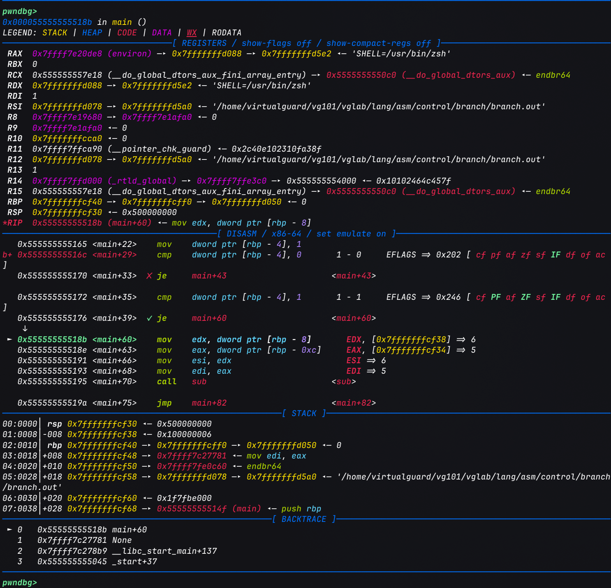

    指令指针`rip`最终落在`main+60`(静态地址`0x118b`), 这就与前文的分析一致了, 控制流确实进入了`sub`分支.

### IDA静态分析

另外, 从上面的C程序中不难看出, `sub`函数也是具有分支结构的(三目运算符单行返回), 分析流程大体相同, 这里不再展开.

用IDA静态分析简单带过一下:

首先在IDA中找到`sub`函数的入口:

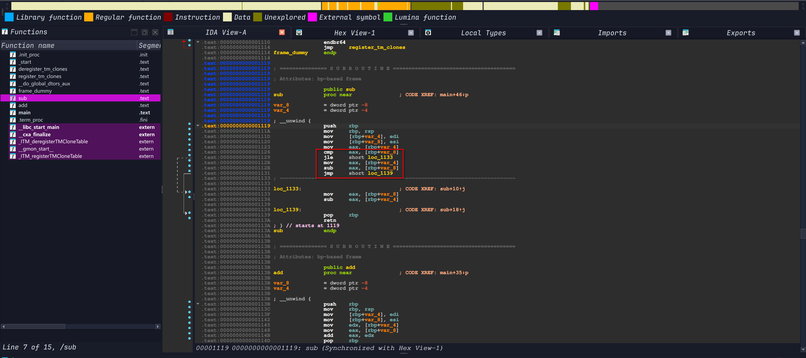

基于前面分析`main`函数的经验, 不难发现红色方框标记的就是`sub`函数中的分支点.

同时简单分析一下红色方框前的三个`mov`指令, 它们将`sub`函数的参数从寄存器搬到栈上, 为后续的比较和计算做准备.

这里寄存器存储的参数值的对应关系为: `edi` -> `a`(从寄存器写入栈上`[rbp - 0x4]`), `esi` -> `b`(从寄存器写入栈上`[rbp - 0x8]`), `eax` -> `a`(第三条`mov`指令将`a`的值从栈上写入寄存器`eax`作为左操作数).

接下来就是分支分析的核心部分了, 即红框内的五条指令(IDA中栈变量被命名为`var_4`=`a`, `var_8`=`b`):

```asm
cmp  eax, [rbp+var_8]      ; eax(a) - b, 只更新标志位
jle  short loc_1133        ; a <= b 时跳到 loc_1133
mov  eax, [rbp+var_4]      ; 不跳转: eax = a
sub  eax, [rbp+var_8]      ; eax = a - b
jmp  short loc_1139        ; 跳过另一分支, 到函数出口
```

- `cmp` + `jle`: 比较`a`与`b`. `jle`是**有符号**"小于等于"跳转, 条件为`ZF = 1`或`SF != OF`(参见[标志位与跳转指令对照表](x86-64汇编基础.md#跳转与控制流)). 这里之所以用有符号跳转, 是因为`a`、`b`在C中是`int`.

- 不跳转(`a > b`): 顺序执行红框内的`mov` + `sub`, 得到`a - b`, 再由`jmp`跳过`loc_1133`, 直达`loc_1139`.

- 跳转(`a <= b`): 到达`loc_1133`, 执行`mov eax, [rbp+var_8]` + `sub eax, [rbp+var_4]`, 得到`b - a`, 然后顺序落入`loc_1139`. 对应源码中的`a <= b`(`a = 5`, `b = 6`)的情况.

- `loc_1139`: 两条分支的汇合点, `pop rbp; ret`返回. 结果都放在`eax`中, 这就是返回值的约定.

可以看到, 三目运算符`(a > b) ? (a - b) : (b - a)`被翻译成了"条件跳转 + 两段代码 + 汇合点"的结构.

编译器为了让`a > b`(条件为真)的代码紧跟在比较之后, 把条件反转为`jle`, 这与前面`if`语句的翻译思路是一致的.

从上面截图左侧的箭头也不难看出分支的走向. 虽然但是关于分支的分析在IDA中使用Graph视图会更加直观, 可以清楚地看到条件跳转、两段代码以及汇合点的结构:

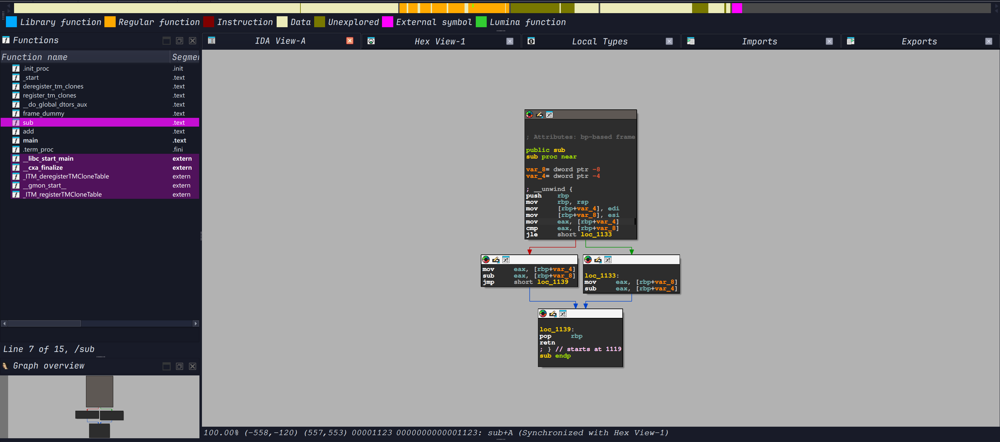

## 循环

循环在汇编中没有专门的指令, 本质上仍是[条件跳转](#条件分支), 只不过跳转目标在当前指令**之前**(回跳). 因此识别循环的关键是: 找到向低地址跳转的条件跳转(回边), 它与跳转目标之间的代码就是循环体.

假设有以下C代码(嵌套循环, 循环体内还调用了函数):

```c
int increase(int n)
{
	return n + 1;
}

int main()
{
	int sum = 0;
	int step = 0;

	while (sum < 55) {
		for (int i = 1; i <= 10; ++i) {
			step = increase(step);
			sum += step;
		}
	}

	return 0;
}
```

编译方式与前文相同:

```bash
gcc loop.c -o loop.out
```

### 反汇编静态分析

同样只关注`main`函数(`objdump`的使用与前文一致).

左侧用折线标出了4条跳转:

- 最左: `116a` → `1140`, 外层`while`的回跳.

- 第二条: `113e` → `1166`, 入口处直达外层条件判断.

- 第三条: `1164` → `1149`, 内层`for`的回跳.

- 最右: `1147` → `1160`, 入口处直达内层条件判断.

```asm
         0000000000001128 <main>:
          1128:	55                   	push   rbp
          1129:	48 89 e5             	mov    rbp,rsp
          112c:	48 83 ec 10          	sub    rsp,0x10
          1130:	c7 45 f4 00 00 00 00 	mov    DWORD PTR [rbp-0xc],0x0
          1137:	c7 45 f8 00 00 00 00 	mov    DWORD PTR [rbp-0x8],0x0
  ┌────── 113e:	eb 26                	jmp    1166 <main+0x3e>
┌─┼─────▶ 1140:	c7 45 fc 01 00 00 00 	mov    DWORD PTR [rbp-0x4],0x1
│ │   ┌── 1147:	eb 17                	jmp    1160 <main+0x38>
│ │ ┌─┼─▶ 1149:	8b 45 f8             	mov    eax,DWORD PTR [rbp-0x8]
│ │ │ │   114c:	89 c7                	mov    edi,eax
│ │ │ │   114e:	e8 c6 ff ff ff       	call   1119 <increase>
│ │ │ │   1153:	89 45 f8             	mov    DWORD PTR [rbp-0x8],eax
│ │ │ │   1156:	8b 45 f8             	mov    eax,DWORD PTR [rbp-0x8]
│ │ │ │   1159:	01 45 f4             	add    DWORD PTR [rbp-0xc],eax
│ │ │ │   115c:	83 45 fc 01          	add    DWORD PTR [rbp-0x4],0x1
│ │ │ └─▶ 1160:	83 7d fc 0a          	cmp    DWORD PTR [rbp-0x4],0xa
│ │ └──── 1164:	7e e3                	jle    1149 <main+0x21>
│ └─────▶ 1166:	83 7d f4 36          	cmp    DWORD PTR [rbp-0xc],0x36
└──────── 116a:	7e d4                	jle    1140 <main+0x18>
          116c:	b8 00 00 00 00       	mov    eax,0x0
          1171:	c9                   	leave
          1172:	c3                   	ret
```

先确定各局部变量对应的栈槽(IDA中通常会被命名为`var_X`):

| 栈槽 | 变量 | 说明 |
|------|------|------|
| `[rbp-0xc]` | `sum` | 初值`0`, 在内层循环体中累加 |
| `[rbp-0x8]` | `step` | 初值`0`, 每轮被`increase`的返回值覆盖 |
| `[rbp-0x4]` | `i` | `for`的循环变量, 在`0x1140`才初始化 |

再沿着跳转线阅读, 会发现编译器为`while`/`for`生成了固定的"**先跳到条件判断, 再回跳到循环体**"模板:

- `0x113e`: 初始化完成后, 第一条指令是`jmp`到**外层循环的条件判断**`0x1166`, 而不是直接进入循环体. 这样条件判断只需要写在循环末尾一份.

- `0x1166` + `0x116a`: `cmp sum, 0x36`+`jle`. 注意C源码写的是`sum < 55`, 这里变成了`sum <= 54`(`0x36 = 54`). 这是编译器对整数比较的等价变换(`< 55`等价于`<= 54`), 在逆向时要留意. 条件成立时**回跳**到`0x1140`, 即外层循环体的开头.

- `0x1140`: 外层循环体的开头, 同时也是`for`的初始化`i = 1`(`[rbp-0x4] = 1`). 随后`0x1147`的`jmp`同样先跳到内层循环的条件判断`0x1160`.

- `0x1149` - `0x115c`: 内层循环体. 依次完成: 把`step`作为参数传给`increase`(`edi`), 调用后将返回值(`eax`)存回`step`, 再`sum += step`(`add [rbp-0xc], eax`). 最后的`add [rbp-0x4], 1`是`for`的`++i`.

- `0x1160` + `0x1164`: `cmp i, 0xa`+`jle`, 即`i <= 10`, 成立则回跳到内层循环体`0x1149`; 不成立则顺序落入`0x1166`, 重新判断外层条件.

- `0x116c`: 外层条件不成立时, 顺序执行到这里, 即`return 0`.

!!! abstract
    总结一下循环的识别特征:

    1. **回跳**: 条件跳转的目标地址小于自身地址(如`0x1164`跳到`0x1149`), 目标即循环体入口.

    2. **入口处的`jmp`**: 循环体前有一条无条件`jmp`直达末尾的条件判断(`0x113e`, `0x1147`).

    3. **循环变量的更新在循环体末尾**: `i`的自增`add [rbp-0x4], 1`紧挨着条件判断, 对应`for`的第三部分.

    4. **嵌套关系体现在跳转线的包含**: 内层的回跳范围`[0x1149, 0x1164]`完全落在外层的回跳范围`[0x1140, 0x116a]`内.

    由此也能看出, `for`、`while`在汇编层面并无区别, 只是`for`多了初始化和自增两个固定位置. `break`与`continue`也只是跳到循环之后或条件判断处的普通`jmp`.

### 动态调试

同样使用[pwndbg](../../tools/调试器.md#pwndbg)验证. 循环会执行几十轮, 逐条`ni`并不现实, 更合适的方式是**在条件判断处下断点, 观察变量的变化**:

1. 与前文一样, 加载后`starti`, `entry`, `pie`得到基址(本次为`0x555555554000`), 在内层条件判断`0x1160`和外层条件判断`0x1166`下断点:

    ```
    pwndbg> break *0x555555555160
    pwndbg> break *0x555555555166
    pwndbg> c
    Breakpoint 3, 0x0000555555555166 in main ()
    ```

    第一次命中的是外层判断`0x1166`, 因为入口处的`jmp`直接跳到了这里, 此时循环体一次都没有执行过:

    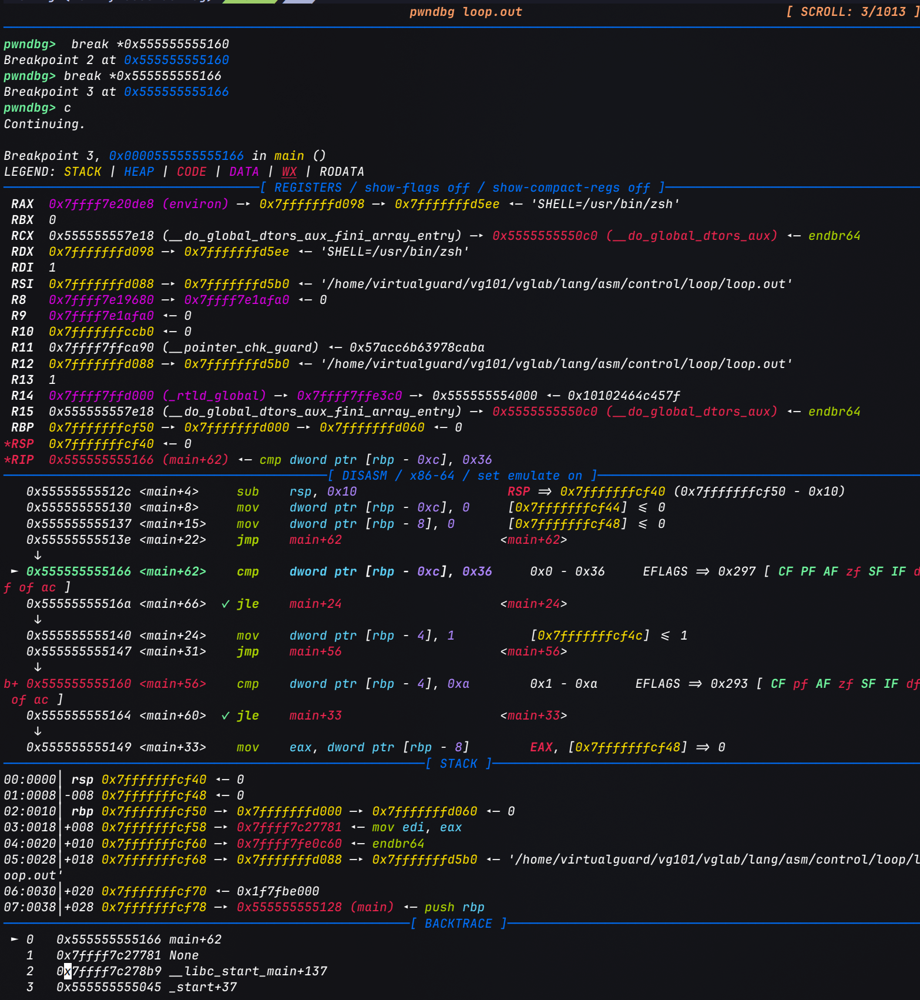

2. 用`x/3dw $rbp-0xc`同时查看`sum`、`step`、`i`(它们在栈上是连续的, 见上面对栈槽的说明与局部变量的表格). 继续运行, 每次命中内层判断`0x1160`时, 都对应内层循环体刚执行完一轮:

    ```
    pwndbg> c                       # 第 1 次命中 0x1160
    pwndbg> x/3dw $rbp-0xc
    0x7fffffffc9e4: 0       0       1
    pwndbg> c                       # 第 2 次命中 0x1160
    pwndbg> x/3dw $rbp-0xc
    0x7fffffffc9e4: 1       1       2
    pwndbg> c                       # 第 3 次命中 0x1160
    pwndbg> x/3dw $rbp-0xc
    0x7fffffffc9e4: 3       2       3
    ```

    依次对应`(sum, step, i)`: 第1次是循环体尚未执行(入口`jmp`直接跳来), 之后每执行一轮, `step`加1, `sum`累加`step`, `i`自增, 即`sum = 1, 3, 6, ...`.

    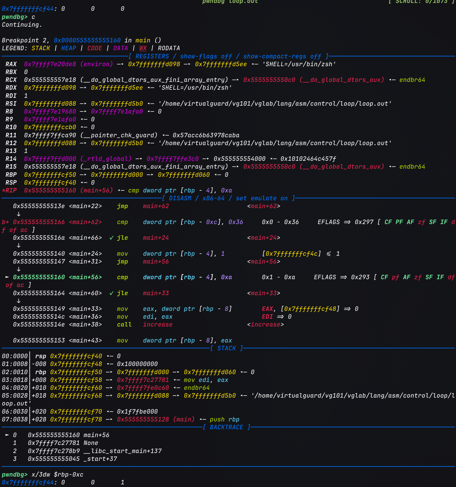

    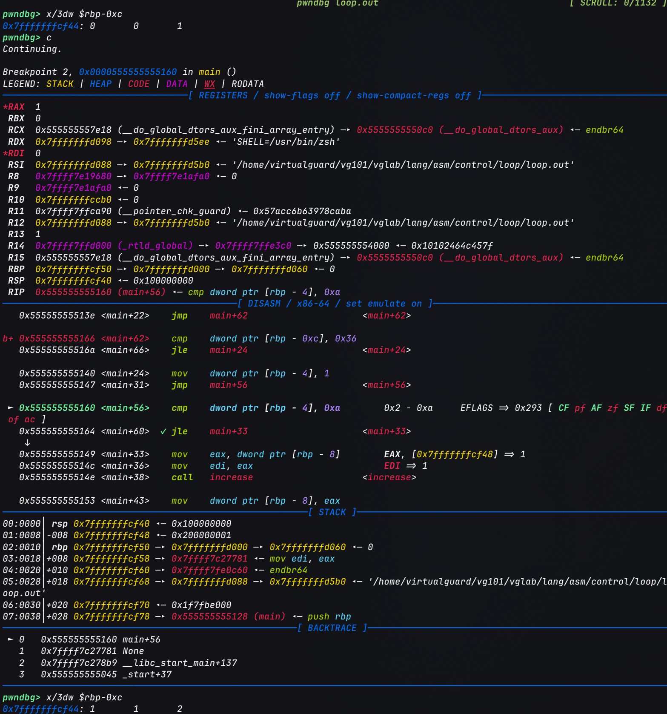

    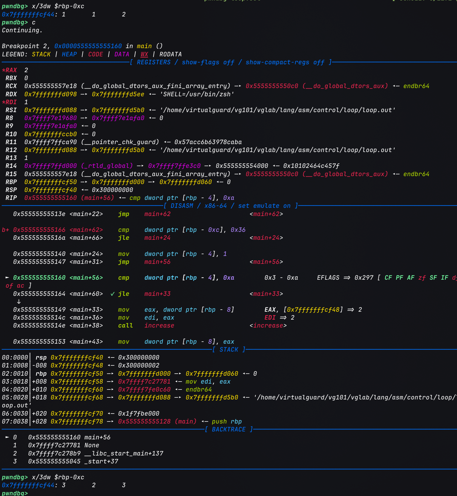

3. 删除内层断点, 直接运行到外层条件判断再次命中, 此时内层循环已经完整地执行了10轮:

    ```
    pwndbg> delete 2
    pwndbg> c
    Breakpoint 3, 0x0000555555555166 in main ()
    pwndbg> x/3dw $rbp-0xc
    0x7fffffffc9e4: 55      10      11
    ```

    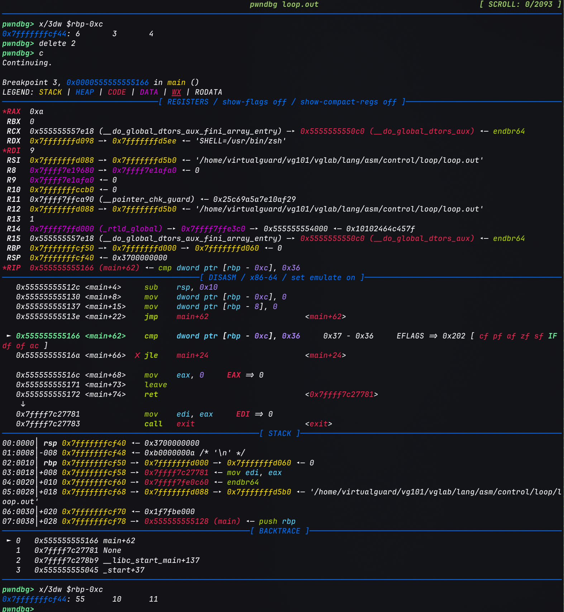

    `sum = 1 + 2 + ... + 10 = 55`, `step = 10`, `i = 11`(跳出内层循环的原因: `11 <= 10`不成立).

4. 用`ni`单步观察外层判断:

    ```
    pwndbg> ni            # 执行 cmp [rbp-0xc], 0x36, 即 55 - 54 > 0
    pwndbg> ni            # jle 不跳转, 顺序到达 0x116c
    pwndbg> info registers rip
    rip     0x55555555516c  <main+68>
    ```

    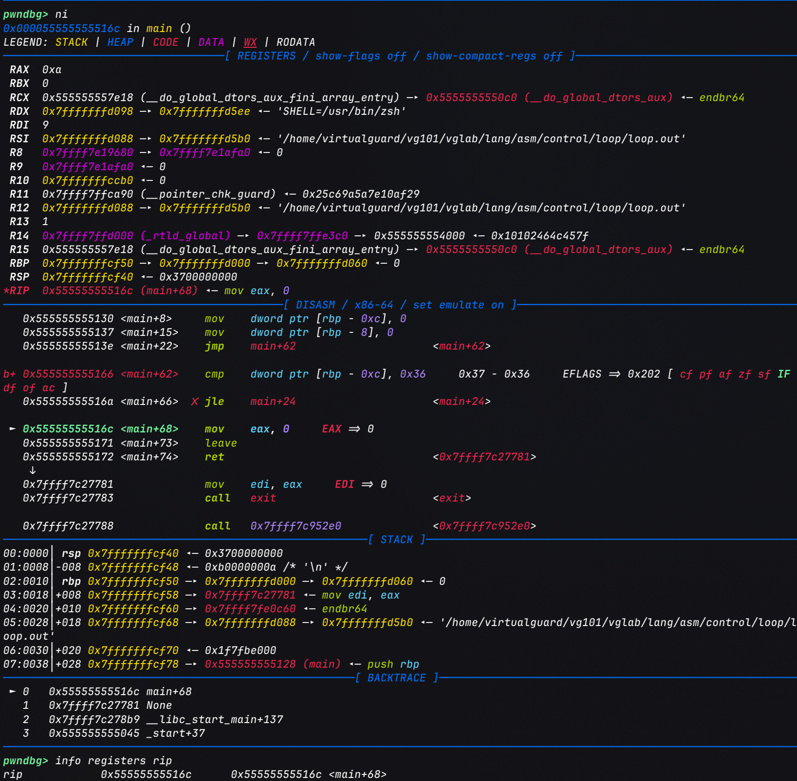

    此时`sum = 55`不满足`sum <= 54`, `jle`不再回跳, 控制流顺序到达`0x116c`(`return 0`). 外层循环因此只执行了一轮.

### IDA静态分析

先看IDA的文本视图, 与`objdump`的结果一致, 但IDA做了两点整理: 一是把跳转目标自动命名为`loc_xxxx`, 二是把栈变量命名为`var_C`, `var_8`, `var_4`(即`[rbp-0xc]`, `[rbp-0x8]`, `[rbp-0x4]`, 对应`sum`, `step`, `i`). 可以在这些名字上按`N`键手动改名, 如改为`sum`, `step`, `i`, 阅读会清晰得多.

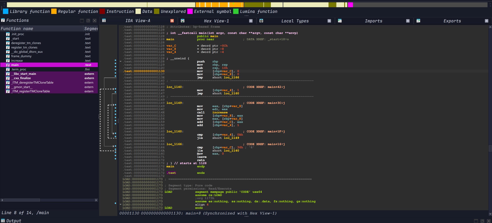

图中左侧的虚线折线是IDA绘制的跳转关系, 虚线框的包含关系就是循环的嵌套关系: 外层虚线框对应`loc_1140`~`loc_1166`(外层循环), 内层虚线框对应`loc_1149`~`loc_1160`(内层循环).

每个`loc_`标签旁的`CODE XREF`注释记录了谁跳转到了这里, 例如`loc_1160`的`XREF: main+1F↑j`, 其中`↑`表示来源在当前地址上方, 即一次回跳. **`↑`的`XREF`是定位循环入口的快捷线索.**

切换到图形视图(空格键), 循环的结构会更加清楚:

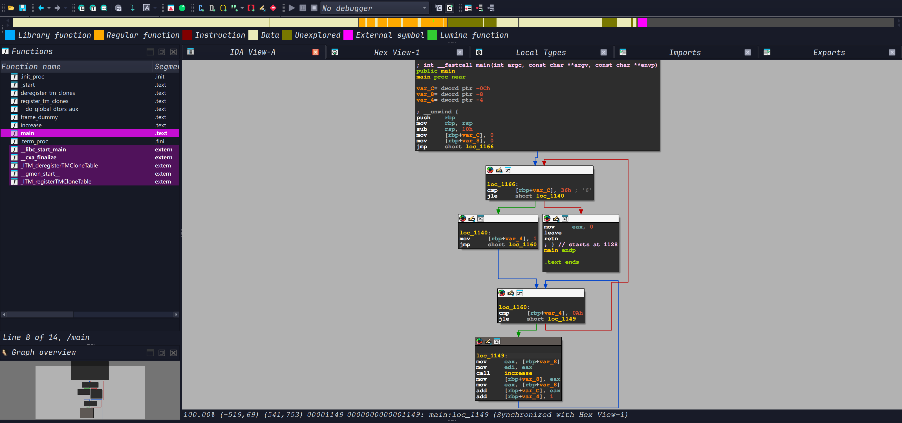

IDA在图中用颜色区分边的类型: 绿色是条件成立时(`jle`跳转)的边, 红色是条件不成立时(顺序执行)的边, 蓝色是无条件的边. 据此可以把图拆成以下几块:

| 基本块 | 内容 | 出边 |
|--------|------|------|
| 入口块 | 栈帧建立, `sum = 0`, `step = 0`, 然后`jmp loc_1166` | 蓝: → `loc_1166` |
| `loc_1166` | `cmp sum, 36h` + `jle`, **外层循环条件** | 绿: → `loc_1140`(进入循环体); 红: → 返回块(退出循环) |
| `loc_1140` | `i = 1`, 然后`jmp loc_1160` | 蓝: → `loc_1160` |
| `loc_1160` | `cmp i, 0Ah` + `jle`, **内层循环条件** | 绿: → `loc_1149`(进入循环体); 红: → `loc_1166`(回到外层条件) |
| `loc_1149` | 内层循环体: 调用`increase`, `sum += step`, `++i` | 蓝: → `loc_1160`(回到内层条件) |
| 返回块 | `mov eax, 0`, `leave`, `retn` | 无 |

读图时可以抓住几个要点:

1. **回边就是循环**: 图中指向上方的边都是回边. 蓝色的`loc_1149` → `loc_1160`是内层循环的回边, 红色的`loc_1160` → `loc_1166`加上绿色的`loc_1166` → `loc_1140`则构成外层循环的回路. 沿回边走一圈形成的环就是循环体.

2. **条件块有两个出口**: `loc_1166`和`loc_1160`都以`cmp` + `jle`结尾, 一个出口留在环内(绿), 另一个离开环(红). 内层的红边并非离开函数, 而是回到外层的条件块, 这正是"嵌套"在图上的体现.

3. **循环条件在环的入口而非末尾**: 无论是`while`还是`for`, 编译器都生成了"入口`jmp`到条件块"的结构, 所以在图中, 入口块和`loc_1140`的蓝边都先指向条件块, 而不是循环体.

4. **`loc_1149`末尾没有显式的跳转**: 循环体最后的`add [rbp+var_4], 1`之后没有`jmp`, 是因为`loc_1160`紧跟其后, 控制流顺序落入. 图中仍然画出了一条蓝边, 这是IDA根据地址顺序补出的.
