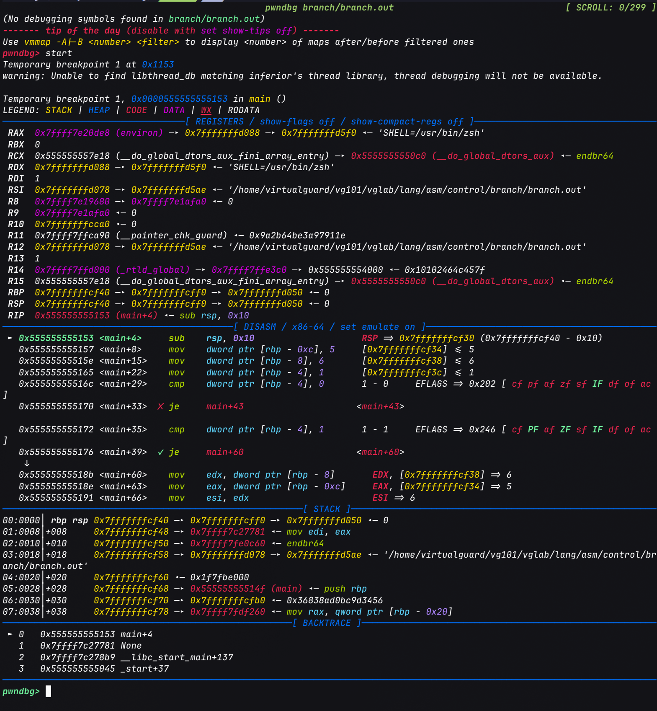
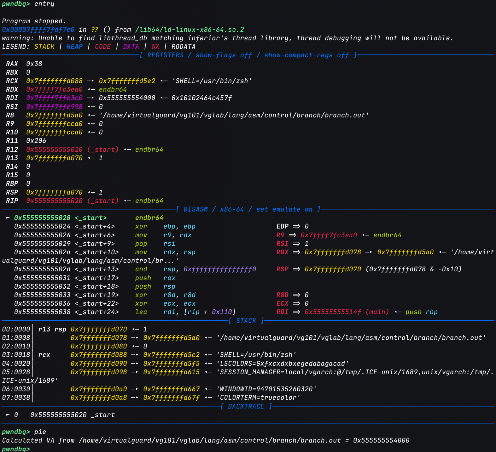
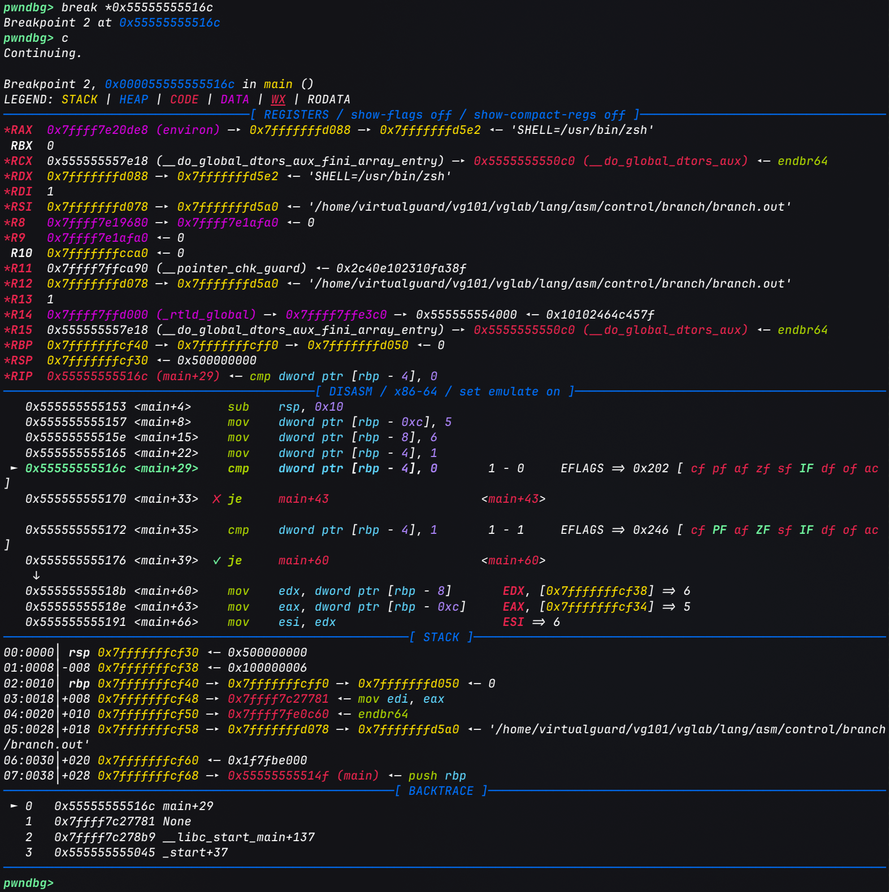

# 汇编中的程序控制流

> [控制语句 | 百度百科](https://baike.baidu.com/item/%E6%8E%A7%E5%88%B6%E8%AF%AD%E5%8F%A5/10507605)

程序控制语句是指在程序执行过程中, 根据特定条件决定程序执行路径的语句.

在C语言中, 常见的程序控制语句包括条件分支语句(如if、switch)和循环语句(如for、while、do-while). 此外还有转向类语句(如goto、break、continue), 但与前两者在本质上并无太大区别(至于为什么这么说, 看完本文就知道了), 本文主要关注前面两者.

在了解了[汇编基础](x86-64汇编基础.md)后, 就可以进一步学习C程序中的程序控制语句在汇编中长什么样了. 在逆向工程与二进制分析中, 这部分知识尤为重要.

## 条件分支

其实这部分内容在学习[x86汇编基础](x86-64汇编基础.md)时就已经[有所涉及](x86-64汇编基础.md#跳转与控制流), 本质上是基于[cmp指令和标志位](x86-64汇编基础.md#算术比较与标志位)的条件跳转.

假设有以下C代码:

```c
int sub(int a, int b)
{
	return (a > b) ? (a - b) : (b - a);
}

int add(int a, int b)
{
	return a + b;
}

int main()
{
	int a = 5;
	int b = 6;
	int mode = 1;

	switch (mode) {
		case 0:
			return add(a, b);
		case 1:
			return sub(a, b);
		default:
			return 0;
	}
}
```

使用以下命令将其编译为可执行文件:

```bash
gcc branch.c -o branch.out
```

为了模拟真实的逆向分析流程, 这里我们不添加调试信息(`-g`参数).

### 反汇编静态分析

接下来反汇编生成的可执行文件:

```bash
objdump -drwC -Mintel branch.out > exec.s
```

这里可以发现, 这时生成的反汇编文本比学习基础汇编时针对目标文件(`.o`)的反汇编要复杂得多, 因为它包含了完整的可执行文件的各个部分, 包括初始化代码、全局构造函数、全局析构函数等.

我们只需关注主逻辑部分即可. 其中`switch`被编译器翻译成了"逐个`cmp` + `je`"的比较链(分支较多且case值密集时, 编译器可能改用跳转表):

```asm
       000000000000114f <main>:
       114f:	55                   	push   rbp
       1150:	48 89 e5             	mov    rbp,rsp
       1153:	48 83 ec 10          	sub    rsp,0x10
       1157:	c7 45 f4 05 00 00 00 	mov    DWORD PTR [rbp-0xc],0x5
       115e:	c7 45 f8 06 00 00 00 	mov    DWORD PTR [rbp-0x8],0x6
       1165:	c7 45 fc 01 00 00 00 	mov    DWORD PTR [rbp-0x4],0x1
       116c:	83 7d fc 00          	cmp    DWORD PTR [rbp-0x4],0x0
    -- 1170:	74 08                	je     117a <main+0x2b>
    |  1172:	83 7d fc 01          	cmp    DWORD PTR [rbp-0x4],0x1
  --+- 1176:	74 13                	je     118b <main+0x3c>
--+-+- 1178:	eb 22                	jmp    119c <main+0x4d>
| | -> 117a:	8b 55 f8             	mov    edx,DWORD PTR [rbp-0x8]
| |    117d:	8b 45 f4             	mov    eax,DWORD PTR [rbp-0xc]
| |    1180:	89 d6                	mov    esi,edx
| |    1182:	89 c7                	mov    edi,eax
| |    1184:	e8 b2 ff ff ff       	call   113b <add>
| | -- 1189:	eb 16                	jmp    11a1 <main+0x52>
| --+> 118b:	8b 55 f8             	mov    edx,DWORD PTR [rbp-0x8]
|   |  118e:	8b 45 f4             	mov    eax,DWORD PTR [rbp-0xc]
|   |  1191:	89 d6                	mov    esi,edx
|   |  1193:	89 c7                	mov    edi,eax
|   |  1195:	e8 7f ff ff ff       	call   1119 <sub>
| --+- 119a:	eb 05                	jmp    11a1 <main+0x52>
--+-+> 119c:	b8 00 00 00 00       	mov    eax,0x0
  ---> 11a1:	c9                   	leave
       11a2:	c3                   	ret
```

左侧的箭头基于跳转关系标出了每条跳转指令(`--`起点)与其目标地址(`>`终点), `+`表示与其他跳转线交叉, 可对照下面的说明阅读.

- `0x116c`: `cmp [rbp-0x4], 0` 比较`mode`与`case 0`, 相等则`je`跳到`add`分支

- `0x1172`: `cmp [rbp-0x4], 1` 比较`mode`与`case 1`, 相等则`je`跳到`sub`分支

- `0x1178`: 都不相等时无条件`jmp`到`default`分支(`eax = 0`)

- 每个分支的`return`都被翻译为"调用后`jmp`到公共出口`11a1`", 由`leave; ret`统一返回, 这也是上面提到的`break`/`goto`与普通跳转本质一致的原因

### 动态调试

接下来使用[pwndbg](../../tools/调试器.md#pwndbg)开始调试, 以验证我们的关于反汇编代码的分析:



由于没有`-g`且默认开启PIE, 程序加载基址是随机化的, 不能直接按反汇编中的地址(如`0x116c`)下断点. 流程如下:

1. 加载程序并停在入口, 用`pie`查看加载基址(本次为`0x555555554000`):

    ```
    pwndbg> starti
    pwndbg> entry
    pwndbg> pie
    Calculated VA from branch.out = 0x555555554000
    ```

    

2. 基址 + 静态偏移即为运行时地址: `0x555555554000 + 0x116c = 0x55555555516c`, 即第一条`cmp`, 在此下断点并运行:

    ```
    pwndbg> break *0x55555555516c
    pwndbg> c
    Breakpoint 1, 0x000055555555516c in main ()
    ```

3. 此时`context`的`DISASM`区域会基于当前栈上的值预测比较结果与跳转方向(`✘`表示不跳, `✔`表示跳):

    ```
    ► 0x55555555516c <main+29>  cmp  dword ptr [rbp - 4], 0   1 - 0
      0x555555555170 <main+33>  ✘ je   main+43
      0x555555555172 <main+35>  cmp  dword ptr [rbp - 4], 1   1 - 1
      0x555555555176 <main+39>  ✔ je   main+60
      0x55555555518b <main+60>  mov  edx, dword ptr [rbp - 8]   EDX => 6
      0x55555555518e <main+63>  mov  eax, dword ptr [rbp - 0xc] EAX => 5
      0x555555555195            call sub
    ```

    

    `mode = 1`, 第一次比较不相等, 第二次相等, 因此预测会走向`sub`分支, 且传参为`edi = 5`, `esi = 6`.

    这里可以留意一下右侧的**EFLAGS**区域, 从图中来看`ZF`标志位处于未置位状态, 直接影响`je`是否跳转. 

    !!! review "x86_64 EFLAGS"
        关于各标志位的含义和作用, 可参考[x86-64汇编基础中的说明](x86-64汇编基础.md#跳转与控制流).

4. 用`ni`单步验证标志位变化. 执行完第一条`cmp`后`ZF`未置位, `je`不跳转; 执行完第二条`cmp`后`ZF`置位, `je`跳转:

    ```
    pwndbg> ni            # 执行 cmp ..., 0
    pwndbg> info registers eflags
    eflags  0x202  [ IF ]
    pwndbg> ni            # je 不跳转, 到达第二条 cmp
    pwndbg> ni            # 执行 cmp ..., 1
    pwndbg> ni            # je 跳转
    pwndbg> info registers eflags rip
    eflags  0x246  [ PF ZF IF ]
    rip     0x55555555518b  <main+60>
    ```

    

    指令指针`rip`最终落在`main+60`(静态地址`0x118b`), 这就与前文的分析一致了, 控制流确实进入了`sub`分支.

### IDA静态分析

另外, 从上面的C程序中不难看出, `sub`函数也是具有分支结构的(三目运算符单行返回), 分析流程大体相同, 这里不再展开.

用IDA静态分析简单带过一下:

首先在IDA中找到`sub`函数的入口:


基于前面分析`main`函数的经验, 不难发现红色方框标记的就是`sub`函数中的分支点.

同时简单分析一下红色方框前的三个`mov`指令, 它们将`sub`函数的参数从寄存器搬到栈上, 为后续的比较和计算做准备.

这里寄存器存储的参数值的对应关系为: `edi` -> `a`(从寄存器写入栈上`[rbp - 0x4]`), `esi` -> `b`(从寄存器写入栈上`[rbp - 0x8]`), `eax` -> `a`(第三条`mov`指令将`a`的值从栈上写入寄存器`eax`作为左操作数).

接下来就是分支分析的核心部分了, 即红框内的五条指令(IDA中栈变量被命名为`var_4`=`a`, `var_8`=`b`):

```asm
cmp  eax, [rbp+var_8]      ; eax(a) - b, 只更新标志位
jle  short loc_1133        ; a <= b 时跳到 loc_1133
mov  eax, [rbp+var_4]      ; 不跳转: eax = a
sub  eax, [rbp+var_8]      ; eax = a - b
jmp  short loc_1139        ; 跳过另一分支, 到函数出口
```

- `cmp` + `jle`: 比较`a`与`b`. `jle`是**有符号**"小于等于"跳转, 条件为`ZF = 1`或`SF != OF`(参见[标志位与跳转指令对照表](x86-64汇编基础.md#跳转与控制流)). 这里之所以用有符号跳转, 是因为`a`、`b`在C中是`int`.

- 不跳转(`a > b`): 顺序执行红框内的`mov` + `sub`, 得到`a - b`, 再由`jmp`跳过`loc_1133`, 直达`loc_1139`.

- 跳转(`a <= b`): 到达`loc_1133`, 执行`mov eax, [rbp+var_8]` + `sub eax, [rbp+var_4]`, 得到`b - a`, 然后顺序落入`loc_1139`. 对应源码中的`a <= b`(`a = 5`, `b = 6`)的情况.

- `loc_1139`: 两条分支的汇合点, `pop rbp; ret`返回. 结果都放在`eax`中, 这就是返回值的约定.

可以看到, 三目运算符`(a > b) ? (a - b) : (b - a)`被翻译成了"条件跳转 + 两段代码 + 汇合点"的结构.

编译器为了让`a > b`(条件为真)的代码紧跟在比较之后, 把条件反转为`jle`, 这与前面`if`语句的翻译思路是一致的.

关于分支的分析在IDA中使用Graph视图会更加直观, 可以清楚地看到条件跳转、两段代码以及汇合点的结构:


## 循环
