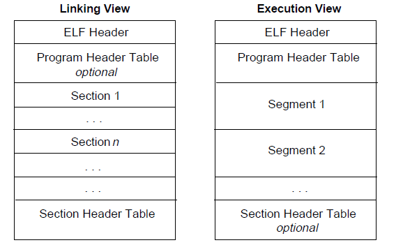
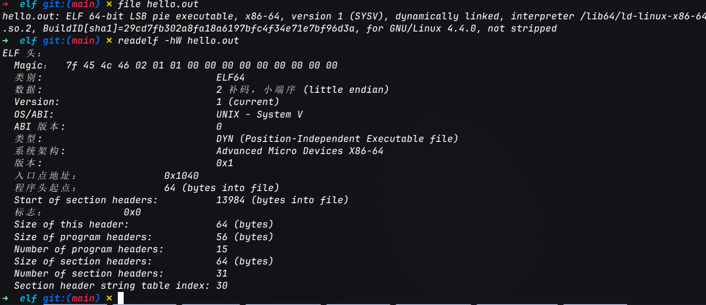
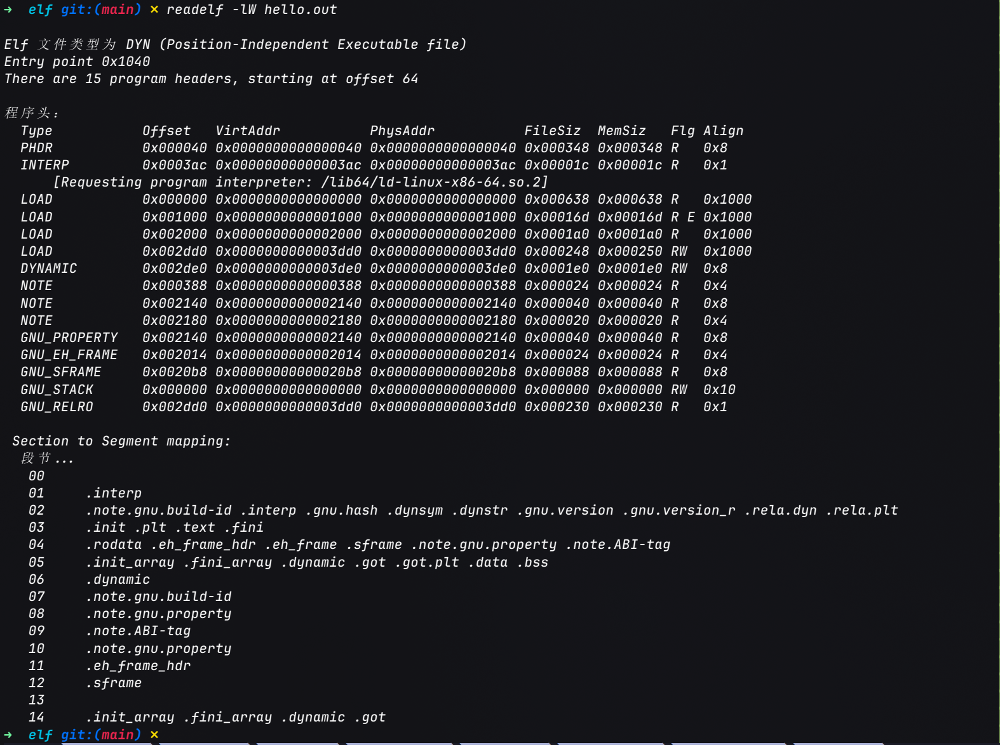
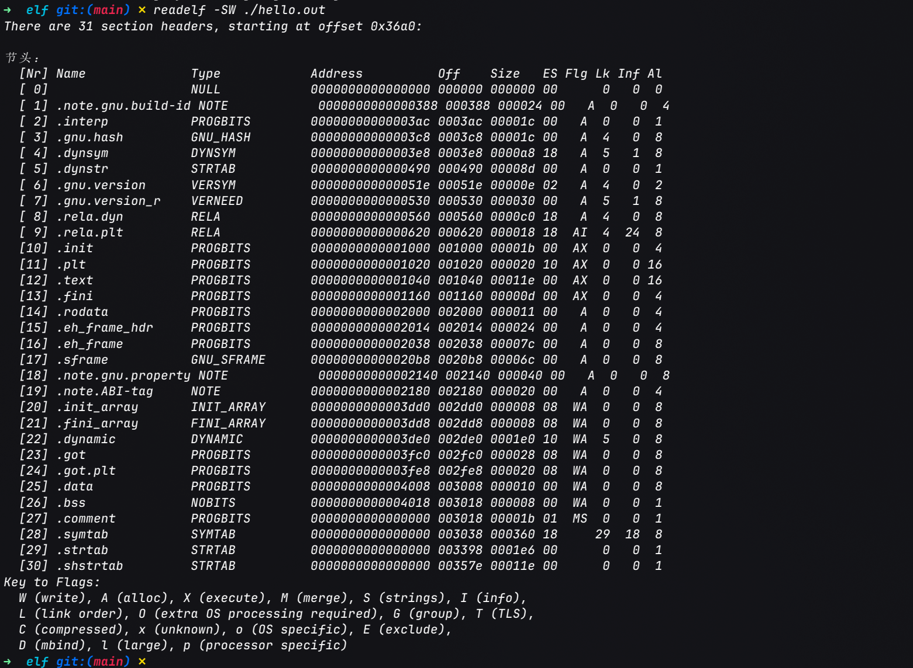
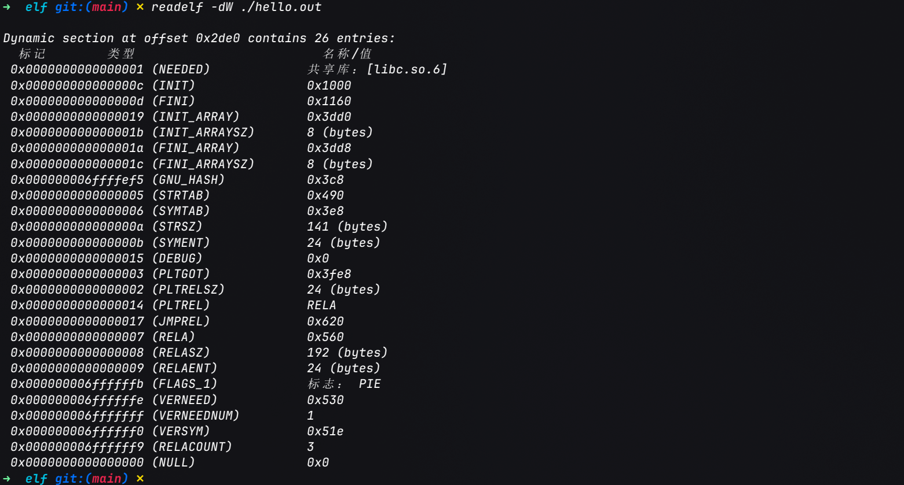
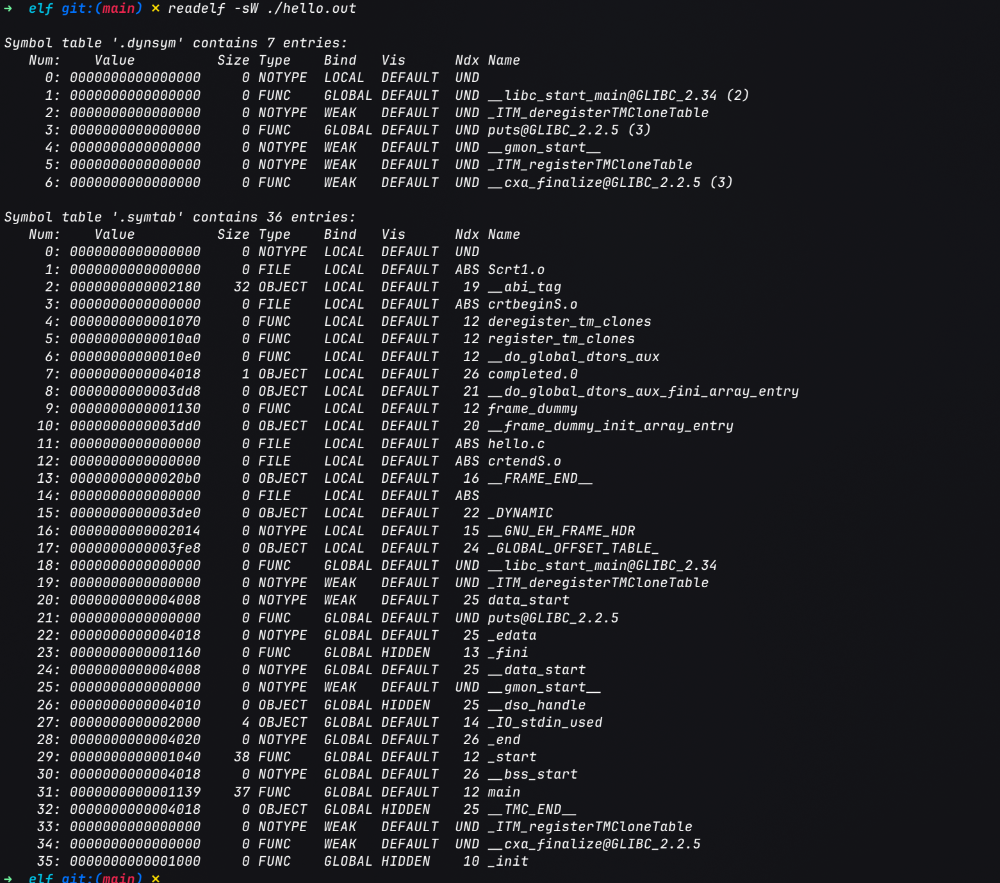
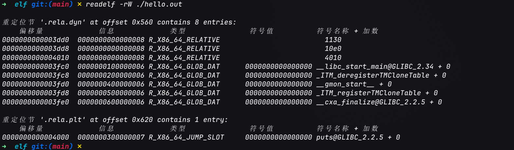

# 可执行文件

> [ELF 文件 | CTF Wiki](https://ctf-wiki.org/executable/elf/structure/basic-info/)
>
> [程序加载 | CTF Wiki](https://ctf-wiki.org/executable/elf/program-loading/)
>
> [程序链接 | CTF Wiki](https://ctf-wiki.org/executable/elf/linking/program-linking/)
>
> [Symbol Resolution | CTF Wiki](https://ctf-wiki.org/executable/elf/linking/symbol-resolve/)
>
> [程序执行流程 | CTF Wiki](https://ctf-wiki.org/executable/elf/running-overview/)

> [System V ABI: Program Loading and Dynamic Linking](https://gabi.xinuos.com/elf/07-loading-intro.html): ELF 通用 ABI 规范, 介绍程序头、加载和动态链接.
>
> [System V AMD64 ABI (x86-64 psABI)](https://gitlab.com/x86-psABIs/x86-64-ABI): x86-64 平台的 ABI 补充规范.
>
> [execve(2) | Linux man-pages](https://man7.org/linux/man-pages/man2/execve.2.html) 与 [ld.so(8) | Linux man-pages](https://man7.org/linux/man-pages/man8/ld.so.8.html): Linux 程序替换和动态链接器的手册.
>
> [ELF | Linux kernel documentation](https://docs.kernel.org/next/ELF/index.html): Linux 内核对 ELF 的说明.

!!! abstract
    **ELF** (*Executable and Linkable Format*) 是 Linux 等系统常用的目标文件格式. 它既描述代码和数据如何参与链接, 也描述操作系统如何把程序映射到进程地址空间.

    理解 ELF 时要区分两个阶段: 静态链接器在构建时组合目标文件并处理重定位; `execve()` 和动态链接器在运行时装入程序及其共享库, 再把控制权交给程序入口.

学习完[汇编基础](../lang/asm/汇编中的程序控制流.md)后, 接下来进一步了解[x86_64架构](../lang/asm/x86-64汇编基础.md)下的可执行文件及其链接、加载和执行过程. 本文以 Linux ELF 为例介绍可执行文件的结构和加载过程. ELF 是文件格式, 具体加载规则还取决于操作系统和处理器 ABI.

## 从源文件到进程

```text
C/C++ 源文件
  | 编译、汇编
  v
可重定位文件 (.o)
  | 静态链接器 ld
  v
可执行文件 / 共享库
  | execve() 触发内核装载
  v
进程地址空间
  | 动态链接器装入依赖库、完成动态重定位
  v
程序入口 _start -> 运行时初始化 -> main()
```

汇编器生成的 `.o` 文件通常是 `ET_REL` 类型, 其中仍可能有未定义符号和重定位项. 静态链接器根据符号表和重定位信息组合各个目标文件, 并生成可执行文件或共享库. “静态链接”描述的是构建时的链接方式, 不代表所有可执行文件都不需要运行时装载器.

## ELF 的文件类型和两种视图

ELF 头部以 `0x7f E L F` 魔数开头, 并记录文件类别、字节序、目标机器、文件类型、入口地址以及程序头表和节区头表的位置. 常见文件类型如下:

| 类型 | 常见用途 |
|:-----|:---------|
| `ET_REL` | 可重定位目标文件, 如编译生成的 `.o` |
| `ET_EXEC` | 可执行文件 |
| `ET_DYN` | 共享目标文件; 现代 Linux 上以 PIE 方式构建的可执行文件也常使用此类型 |
| `ET_CORE` | 进程崩溃或转储时生成的 core 文件 |

ELF 同时提供链接视图和执行视图:



- **节区 (section)**主要服务于链接、调试和分析, 例如 `.text`、`.rodata`、`.data`、`.bss`、`.symtab` 和 `.rela.dyn`.

- **段 (segment)**由程序头表描述, 面向装载器, 指定运行时需要映射的文件范围、内存大小、权限和对齐方式. 一个可装载段可以覆盖多个节区, 也可能包含不对应具名节区的数据.

```text
                 ELF 文件
                     |
         +-----------+-----------+
         |                       |
      链接视图                 执行视图
   (Section Header)         (Program Header)
         |                       |
   +-----+-----+           +-----+------------------+
   |     |     |           |     |                  |
 .text .data .symtab    PT_LOAD PT_INTERP      PT_DYNAMIC
   |     |     |           |        |                |
 指令 全局数据 符号表      段映射   动态链接器路径     动态链接元信息
```

Linux 下, `readelf -S` 查看的是节区表, `readelf -l` 查看的是程序头表.

运行程序主要依赖程序头表. 即使节区头表被剥离, 装载器仍可通过程序头表和动态链接信息工作.

常见程序头类型:

| 类型 | 作用 |
|:-----|:-----|
| `PT_LOAD` | 描述需要映射到进程地址空间的段. `p_filesz` 是文件中的字节数, `p_memsz` 是内存中的字节数; 当 `p_memsz > p_filesz` 时, 多出的部分初始化为零, 常用于 `.bss` |
| `PT_INTERP` | 指定动态链接器的路径, 例如 glibc 系统上的 `ld-linux-x86-64.so.2` |
| `PT_DYNAMIC` | 指向动态链接所需的信息, 如依赖库、符号表、重定位表等 |

文件偏移和运行时虚拟地址不是同一个概念. 对于 `PT_LOAD`, 程序头表把文件中的一段内容映射到指定的虚拟地址范围; 动态装载时还可能根据装载基址 (load bias) 调整地址.

## 链接: 符号与重定位

编译一个源文件时, 编译器通常不知道其他目标文件或共享库中函数、变量的最终地址. 它会在符号表中记录定义或未定义符号, 并在重定位表中记录需要修正的位置及计算方式.

链接器处理目标文件时, 大致会:

1. 收集输入文件中的节区, 按规则布局输出文件.

2. 解析符号引用, 将未定义引用与某个定义关联.

3. 根据重定位类型计算地址或偏移, 修正指令和数据中的占位值.

4. 输出可执行文件或共享库, 并保留运行时仍需处理的动态链接信息.

```text
┌──────────────────────────┐      ┌──────────────────────────┐
│ a.o                      │      │ b.o / libc.so.6          │
│ (.text, .data, .symtab,  │      │ (defines external sym)   │
│  .rela.text, ...)        │      │                          │
└──────────────┬───────────┘      └──────────────┬───────────┘
               │                                 │
               └───────────────┬─────────────────┘
                               ▼
                  ┌─────────────────────────────┐
                  │ linker (ld)                 │
                  │ 1) merge sections/layout    │
                  │ 2) resolve UND -> definition│
                  │ 3) apply relocations        │
                  └──────────────┬──────────────┘
                                 │
                   ┌─────────────┴─────────────┐
                   ▼                           ▼
      ┌─────────────────────────┐   ┌─────────────────────────┐
      │ static-linked output    │   │ dynamic-linked output   │
      │ code merged into binary │   │ keeps DT_NEEDED / UND / │
      │ no runtime symbol lookup│   │ .rela.dyn / .rela.plt   │
      └─────────────────────────┘   └──────────┬──────────────┘
                                               ▼
                                     runtime binding by ld.so
```

静态链接会把所需目标代码并入输出文件, 通常不需要在运行时查找这些符号对应的共享库定义. 动态链接则在可执行文件中保留 `DT_NEEDED` 等依赖信息, 由动态链接器在运行时装入共享库并完成剩余的重定位和符号绑定.

在 x86-64 位置无关代码中, **GOT (Global Offset Table)**保存运行时需要访问的地址, **PLT (Procedure Linkage Table)**为外部函数调用提供跳转入口. 动态链接器可在启动时完成函数绑定, 也可能按需在首次调用时解析 PLT 项; 是否采用延迟绑定取决于 ABI、链接选项和运行环境, 不应假定每个程序都会延迟解析.

延迟绑定时, 对外部函数 (以 `puts` 为例) 的首次与后续调用大致如下:

```text
first call path                               next call path
───────────────                               ──────────────
call puts@plt                                 call puts@plt
      │                                             │
      ▼                                             ▼
puts@plt: jmp *GOT[puts]                       puts@plt: jmp *GOT[puts]
      │ (GOT entry still points to PLT stub)        │ (GOT already patched)
      ▼                                             ▼
push reloc_index; jmp PLT0                      libc puts
      │
      ▼
PLT0: push link_map; jmp *GOT[2]
      │
      ▼
dynamic linker (_dl_runtime_resolve)
      │ resolve symbol + write real addr to GOT[puts]
      ▼
jump to libc puts
```

## ELF的装入与启动 

`execve(path, argv, envp)` 成功时会用新程序替换当前进程的程序映像, 它本身不会创建一个新的进程. 对于 ELF 可执行文件, Linux 的装载过程可以概括为:

1. 内核识别 ELF 头部并检查目标架构等信息, 根据程序头表处理 `PT_LOAD` 段.

2. 内核建立新地址空间, 映射程序代码和数据, 并按 `p_memsz` 与 `p_filesz` 的差额补零.

3. 内核准备初始栈, 放入参数、环境变量及辅助向量 (auxiliary vector). 辅助向量向运行时提供入口地址、页面大小等信息.

4. 若文件含 `PT_INTERP`, 内核还会装入指定的动态链接器, 并先把控制权交给动态链接器; 静态可执行文件通常没有这一步.

5. 动态链接器读取动态段中的依赖信息, 装入共享库, 完成所需重定位和符号绑定, 再把控制权交给主程序入口.

6. 在常见的 C 运行时环境中, 程序入口通常是 `_start`; 运行时完成初始化后再调用 `main()`.

```text
                shell / parent process
                        │ execve(path, argv, envp)
                        ▼
┌──────────────────────────────────────────────┐
│ kernel (binfmt_elf)                          │
│ - validate ELF header + map PT_LOAD          │
│ - zero-fill .bss (p_memsz - p_filesz)        │
│ - build initial stack (argc/argv/envp/auxv)  │
│ - if PT_INTERP exists, map ld.so too         │
└───────────────────────┬──────────────────────┘
                        │
              ┌─────────┴─────────┐
              │ dynamic-linked ?  ├────────────────┐
              └─────────┬─────────┘                │
                        │yes                       │no
                        ▼                          │
        ┌──────────────────────────────┐           │
        │ ld.so (ELF interpreter)      │           │
        │ - load DT_NEEDED shared libs │           │
        │ - apply relocations/binding  │           │
        └───────────────┬──────────────┘           │
                        ├──────────────────────────┘
                        ▼
                  e_entry: _start
                        │
                        ▼
                 __libc_start_main
                        │
                        ▼
                    main() ──> exit
```

动态链接器是 ELF 解释器, 不是内核本身. 内核负责建立初始进程映像并启动解释器; 共享库装入、动态符号解析等工作主要由解释器完成. 对于 PIE, 主程序可装入不同的虚拟地址; 地址随机化是否生效还取决于系统配置和进程执行环境.

注意区分 ELF 头部的 `e_entry` 和动态链接器的初始入口: `e_entry` 描述主程序的入口地址; 动态链接程序启动时, 内核先把控制权交给 `PT_INTERP` 指定的解释器, 由解释器完成准备后再跳到主程序入口.


## 观察 ELF 文件

可以用 GNU Binutils 查看一个可执行文件的不同部分:

```bash
file ./program
readelf -hW ./program   # ELF 头部: 类型、架构、入口地址
readelf -lW ./program   # 程序头表: PT_LOAD、PT_INTERP 等
readelf -SW ./program   # 节区头表
readelf -dW ./program   # 动态段和 DT_NEEDED 依赖
readelf -sW ./program   # 符号表
readelf -rW ./program   # 重定位项
objdump -d ./program    # 反汇编
```

推荐按这个顺序观察:

1. 先看 `file` 和 `readelf -hW` 确认文件类型与架构

2. 再看 `readelf -lW` 理解装载段和解释器

3. 最后对照 `readelf -dW`、`-sW`、`-rW` 分析动态依赖、符号和重定位

4. `objdump -d` 则把机器码反汇编, 可与此前的汇编知识对应起来.

### 示例

以 `hello.c` 为例:

```c
#include <stdio.h>

int main(int argc, char *argv[])
{
	printf("Hello World!\n");

	return 0;
}
```

编译后生成的可执行文件可以用前面介绍的工具观察其 ELF 结构:

- 文件类型与架构信息

    ```bash
    file ./hello.out
    readelf -hW ./hello.out
    ```

    

    `file` 显示 `ELF 64-bit LSB pie executable, x86-64, dynamically linked, interpreter /lib64/ld-linux-x86-64.so.2`. `readelf -hW` 中 `Type` 为 `DYN (Position-Independent Executable file)`, 印证前文所说 PIE 使用 `ET_DYN`; 入口 `Entry point address` 为 `0x1040`, 它是 `_start` 而不是 `main` (`0x1139`).

- 程序头表

    ```bash
    readelf -lW ./hello.out
    ```

    

    `INTERP` (`0x3ac`) 指向 `ld-linux-x86-64.so.2`, 另有 4 个权限各不相同的 `PT_LOAD`:

    | 段 | 文件偏移 / 虚拟地址 | 权限 | 包含的节区 |
    |:---|:---|:---|:---|
    | LOAD 1 | `0x0` | `R` | `.interp`, `.dynsym`, `.dynstr`, `.rela.dyn`, `.rela.plt` 等动态链接元数据 |
    | LOAD 2 | `0x1000` | `R E` | `.init`, `.plt`, `.text`, `.fini` |
    | LOAD 3 | `0x2000` | `R` | `.rodata`, `.eh_frame` 等 |
    | LOAD 4 | `0x2dd0` -> `0x3dd0` | `RW` | `.init_array`, `.dynamic`, `.got`, `.got.plt`, `.data`, `.bss` |

    LOAD 4 的 `FileSiz` 为 `0x248`, `MemSiz` 为 `0x250`, 多出的 8 字节就是 `.bss` (`NOBITS`), 装载时补零, 与前文 `p_memsz > p_filesz` 的说明一致. 它的文件偏移 (`0x2dd0`) 与虚拟地址 (`0x3dd0`) 也不相同, 说明二者是两个概念. `GNU_RELRO` 覆盖 `.init_array`, `.dynamic`, `.got`, 动态链接器完成重定位后会将它们改为只读, 而 `.got.plt` 不在其中.

- 节区头表

    ```bash
    readelf -SW ./hello.out
    ```

    

    节区与上表的段一一对应:

    - `.text` (`0x1040`, `AX`) 位于可执行的 LOAD 2

    - `.rodata` (`0x2000`, `A`) 位于只读的 LOAD 3, 字符串 `Hello World!` 就存放在 `.rodata` 中

    - `.got`/`.got.plt`/`.data` (`WA`) 位于可写的 LOAD 4

    - `.bss` 为 `NOBITS`, 不占文件空间

- 动态段

    ```bash
    readelf -dW ./hello.out
    ```

    

    `NEEDED` 只有 `libc.so.6`, `FLAGS_1` 为 `PIE`, 动态链接器会据此装入 `libc.so.6` 并处理重定位. 输出中没有 `BIND_NOW`, 因此函数调用采用延迟绑定.

- 符号表

    ```bash
    readelf -sW ./hello.out
    ```

    

    `main` 与 `_start` 是本文件定义的 `GLOBAL FUNC`; `puts@GLIBC_2.2.5` 与 `__libc_start_main@GLIBC_2.34` 的 `Ndx` 为 `UND`, 即未定义符号, 需由 `libc.so.6` 提供.
    
    另外值得注意的是, 源码调用的是 `printf`, 符号表里却是 `puts`. 这是因为编译器把只含字符串常量且以换行结尾的 `printf` 优化成了 `puts`.

- 重定位项

    ```bash
    readelf -rW ./hello.out
    ```

    

    重定位分两张表:

    | 重定位表 | 类型 | 目标 | 含义 |
    |:---|:---|:---|:---|
    | `.rela.dyn` | `R_X86_64_GLOB_DAT` | `0x3fc0` 等 `.got` 项 | 装载时填入 `__libc_start_main`, `__cxa_finalize` 等外部符号地址 |
    | `.rela.dyn` | `R_X86_64_RELATIVE` | `0x3dd0`, `0x3dd8`, `0x4010` | 不依赖符号, 只需加上装载基址 (load bias), 例如 `.init_array` 中 `frame_dummy` 和 `__do_global_dtors_aux` 的地址 |
    | `.rela.plt` | `R_X86_64_JUMP_SLOT` | `0x4000` | `puts` 对应的 `.got.plt` 项, 首次调用时才被解析 |

- 反汇编

    ```bash
    objdump -d ./hello.out > disasm.s
    ```

    结合上述信息, 可以把一次启动过程在代码里对应起来. 由于完整的反汇编代码篇幅较长, 这里没有贴出, 可在[仓库](https://github.com/virtualguard101/vglab/blob/main/os/elf/disasm.s)中查看它.

    - `_start` (`0x1040`) 按 System V AMD64 ABI 准备参数:

        - `pop %rsi` 取出 `argc`, `mov %rsp,%rdx` 得到 `argv`

        - `lea 0xda(%rip),%rdi` 把 `main` 的地址 (`0x1139`) 放入 `%rdi`

        - 然后 `call *0x2f5b(%rip)` 通过 `0x3fc0` 处的 GOT 项调用 `__libc_start_main`

            这里的 GOT 项正是 `.rela.dyn` 中 `R_X86_64_GLOB_DAT` 所填写的. `__libc_start_main` 不会返回, 所以其后是 `hlt`.

    - `main` (`0x1139`) 先建立栈帧, 把 `argc` (`%edi`) 和 `argv` (`%rsi`) 存入栈; 再用 `lea 0xeb5(%rip),%rax` 取得字符串地址 `0x2004`, 它位于只读的 `.rodata`, 内容为 `Hello World!`; 最后 `call 1030 <puts@plt>` 并通过 `mov $0x0,%eax` 设置返回值 `0`.

    - `puts@plt` (`0x1030`) 是延迟绑定的典型结构:

        ```asm
        1030: jmp  *0x2fca(%rip)   # 跳到 GOT[puts] (0x4000)
        1036: push $0x0            # 重定位项索引
        103b: jmp  1020            # 跳到 PLT0
        1020: push 0x2fca(%rip)    # 压入 link_map (GOT+0x8)
        1026: jmp  *0x2fcc(%rip)   # 跳到 _dl_runtime_resolve (GOT+0x10)
        ```

        首次调用时, `GOT[puts]` 里存的是 `0x1036` (即 PLT 项的下一条指令), 控制流经 PLT0 进入动态链接器解析 `puts`, 并把真实地址写回 `0x4000`. 之后再次调用 `puts@plt` 时, 第一条 `jmp` 就会直接跳到 `libc` 中的 `puts`.

    - 其余函数 (`_init`、`deregister_tm_clones`、`frame_dummy` 等) 是 C 运行时的初始化/清理代码, 不属于 `hello.c`. `frame_dummy` 与 `__do_global_dtors_aux` 的地址被放入 `.init_array`/`.fini_array`, 即上面 `R_X86_64_RELATIVE` 修正的对象.

由此, 一个只有三行的程序在 ELF 中就能完整对应前文的链接与装载流程: 

- 内核根据 `PT_LOAD` 映射文件并启动 `PT_INTERP` 指定的解释器

- 解释器依据 `DT_NEEDED` 装入 `libc.so.6` 并处理 `.rela.dyn`, 再跳转到 `e_entry` 指向的 `_start`, 最终进入 `main`

- 首次调用 `puts` 时才通过 `.rela.plt` 与 PLT/GOT 完成绑定.
