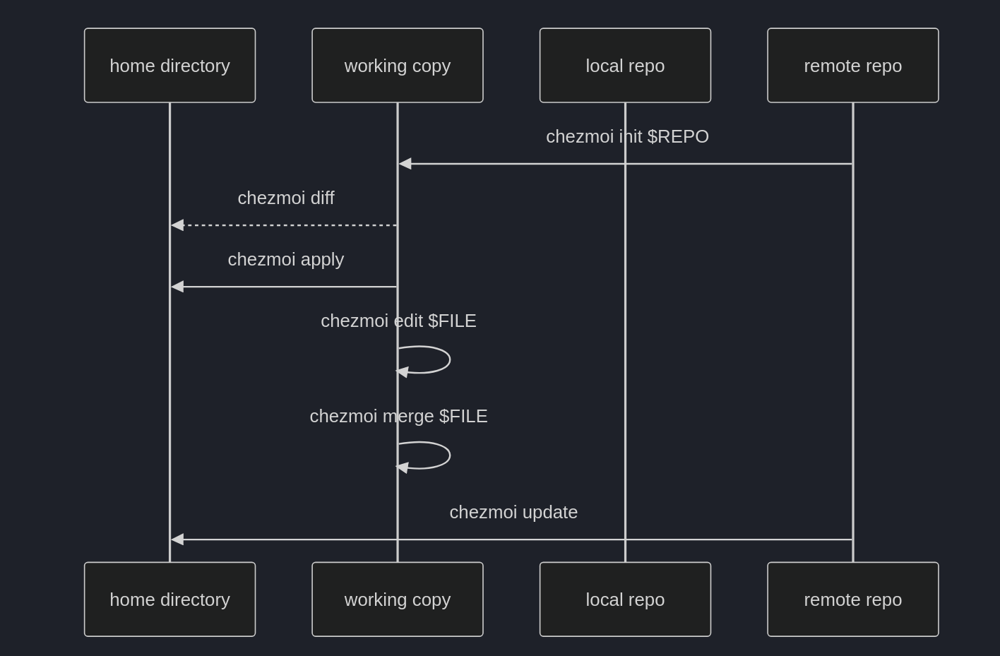

# chezmoi

> [Command overview | chezmoi](https://www.chezmoi.io/user-guide/command-overview/)
>
> [Source state attributes | chezmoi](https://www.chezmoi.io/reference/source-state-attributes/)
>
> [Templating | chezmoi](https://www.chezmoi.io/user-guide/templating/)
>
> [Manage machine-to-machine differences | chezmoi](https://www.chezmoi.io/user-guide/manage-machine-to-machine-differences/)
>
> [age | chezmoi](https://www.chezmoi.io/user-guide/encryption/age/)

**chezmoi** 是一个跨机器管理 dotfiles(用户配置文件)的工具. 它把配置文件的"标准版本"保存在一个 [Git](Git.md) 仓库中, 再按每台机器的情况把它们**复制**到家目录.

与"把 `~/.zshrc` 软链接到仓库"的做法不同, chezmoi 默认生成真实的文件. 这样它可以在复制过程中做额外处理: 渲染模板以适配不同系统, 解密敏感文件, 设置文件权限. 代价是仓库与家目录之间多了"同步"这一步, 需要理解它的方向.

## 安装

> [Installation | chezmoi](https://www.chezmoi.io/install/)

## 核心概念

chezmoi 的所有命令都围绕三个"状态"展开:

| 概念 | 位置 | 含义 |
| --- | --- | --- |
| **源状态**(*source state*) | `~/.local/share/chezmoi` | 仓库中的文件, 文件名带有属性前缀, 例如 `dot_zshrc`, `encrypted_private_dot_npmrc.age` |
| **目标状态**(*target state*) | 计算得到, 不落盘 | 源状态经过模板渲染, 解密, 去掉前缀后, "家目录应该是什么样" |
| **目标目录**(*destination*) | `~` | 真实的家目录 |

源文件名与目标路径一一对应, 例如 `dot_config/private_fcitx5/profile` 对应 `~/.config/fcitx5/profile`. 因此大多数命令既可以接受目标路径, 也能自动找到对应的源文件.



所有同步只有两个方向:

| 方向 | 命令 | 场景 |
| --- | --- | --- |
| `~` → 源状态 | `chezmoi add`, `chezmoi re-add` | 在本地改好了配置, 想保存到仓库 |
| 源状态 → `~` | `chezmoi apply`, `chezmoi update` | 仓库里有新的改动, 想部署到本地 |
| 只比较, 不写入 | `chezmoi status`, `chezmoi diff` | 确认两边差在哪里 |

## 基本使用

### 命令速查

| 命令 | 作用 |
| --- | --- |
| `chezmoi init` | 在 `~/.local/share/chezmoi` 创建并初始化 git 仓库 |
| `chezmoi init <repo>` | 克隆已有的 dotfiles 仓库作为源目录, 并生成配置文件 |
| `chezmoi add <file>` | 把文件纳入管理(复制进源状态) |
| `chezmoi add --encrypt <file>` | 加密后纳入管理, 见[加密](#加密) |
| `chezmoi re-add [file]` | 把已管理文件的本地改动写回源状态 |
| `chezmoi edit <file>` | 编辑对应的源文件; 加密文件会自动解密编辑, 保存时重新加密 |
| `chezmoi edit --apply <file>` | 编辑后立即部署 |
| `chezmoi apply [file]` | 把源状态部署到家目录 |
| `chezmoi update` | 拉取仓库更新并 apply |
| `chezmoi status` | 列出两边的差异, 见[读懂 status](#读懂-status) |
| `chezmoi diff [file]` | 显示 `apply` 会做出的修改 |
| `chezmoi merge <file>` | 三方合并, 见[日常工作流](#日常工作流) |
| `chezmoi managed` | 列出所有被管理的目标 |
| `chezmoi forget <file>` | 停止管理(删除源文件, 保留本地文件) |
| `chezmoi source-path <file>` | 显示目标对应的源文件路径 |
| `chezmoi cat <file>` | 输出目标状态的内容(模板已渲染, 已解密) |
| `chezmoi cd` | 打开一个位于源目录的 shell |
| `chezmoi git -- <args>` | 在源目录执行 git 命令 |

修改性的命令都支持 `--dry-run`(只演示, 不写入), 与 `--verbose` 搭配可以看到将要发生的改动. 更多命令可参考[官方文档](https://www.chezmoi.io/user-guide/command-overview/).

### 读懂 status

`chezmoi status` 每行有两列状态码:

- **第一列**: 上次 chezmoi 写入之后, 本地文件有没有被改过.

- **第二列**: 运行 `apply` 会对本地文件做什么.

| 字符 | 第一列 | 第二列 |
| --- | --- | --- |
| 空格 | 没有变化 | 没有变化 |
| `A` | 本地新建了 | 将会创建 |
| `D` | 本地删除了 | 将会删除 |
| `M` | 本地修改了 | 将会修改 |
| `R` | 不适用 | 将会运行脚本 |

例如:

```text
 M .zshrc                      # 本地没动, 但源状态不同(例如仓库更新了): apply 会更新它
MM .config/fcitx5/profile      # 本地改过, 源状态也不同: apply 会覆盖本地改动
```

第一列为 `M` 时要小心: 直接 `apply` 会丢掉本地的改动. 先决定保留哪一边, 见下一节.

### 日常工作流

1. **本地改了配置, 想保存**: `chezmoi diff <file>` 确认差异, 然后 `chezmoi re-add <file>`(新文件用 `chezmoi add`), 最后在源目录提交.

2. **仓库有更新, 想部署**: `chezmoi update`, 或者 `git pull` 之后先 `chezmoi diff` 再 `chezmoi apply`.

3. **两边都改了**: `chezmoi merge <file>` 打开三方合并界面(默认 vimdiff), 三方分别是本地文件, 源文件和目标状态. 合并结果写回源文件, 再 `chezmoi apply`.

不带 `--force` 时, `apply` 遇到"本地改过"的文件会停下来询问(查看 diff / 覆盖 / 跳过); 加上 `--force` 则直接覆盖.

!!! tip "源目录就是工作目录"
    在新机器上直接把仓库克隆到 `~/.local/share/chezmoi`(即 `chezmoi init <repo>`), 而不是克隆到另一个目录再从那里 apply. 使用默认源目录时所有命令零配置可用; 维护两份副本则迟早会相互偏离.

## 源文件属性

源文件名由**属性前缀** + 目标文件名 + **后缀**组成. 前缀决定文件部署后的属性:

| 前缀 / 后缀 | 作用 |
| --- | --- |
| `dot_` | 目标名以 `.` 开头: `dot_zshrc` → `.zshrc` |
| `private_` | 部署后只有所有者可读写(文件 600, 目录 700) |
| `readonly_` | 去掉写权限 |
| `executable_` | 加上可执行权限 |
| `encrypted_` + `.age` | 源文件是密文, 部署时解密; 两者成对出现 |
| `exact_`(目录) | 目录中未被管理的文件会被删除 |
| `empty_` | 允许部署空文件(默认空文件会被删除) |
| `create_` | 只在目标不存在时创建, 之后不再覆盖 |
| `symlink_` | 部署为符号链接, 文件内容是链接目标 |
| `run_`, `run_once_`, `run_onchange_` | 作为脚本运行, 而不是部署为文件 |
| `literal_` | 停止解析后面的前缀, 例如 `literal_dot_x` → `dot_x` |
| `.tmpl` 后缀 | 作为模板渲染, 见[模板](#模板) |

前缀的**顺序是固定的**, 例如 `encrypted_private_dot_npmrc.age`, `private_executable_dot_local`. 完整的顺序见 [Source state attributes](https://www.chezmoi.io/reference/source-state-attributes/).

属性在 `chezmoi add` 时由文件当前的状态推导. 例如权限为 600 的文件被 add 后, 源文件名会自动带上 `private_`. 因此应该**先把权限设对再 add**, 而不是事后手改文件名.

## 进阶使用

### 模板

文件名以 `.tmpl` 结尾的源文件会先经过 Go 模板(*text/template*)渲染, 再部署. 最常见的用途是让同一个文件适配不同系统. 例如 `dot_gitconfig.tmpl`:

```text
[user]
    name = Your Name
[core]
{{- if eq .chezmoi.os "windows" }}
    autocrlf = true
{{- else }}
    autocrlf = input
{{- end }}
```

常用变量有 `.chezmoi.os`(`linux`, `windows`, `darwin`), `.chezmoi.hostname`, `.chezmoi.homeDir`, `.chezmoi.username`. 完整列表见 [Variables](https://www.chezmoi.io/reference/templates/variables/), 也可以运行 `chezmoi data` 查看当前机器的值.

调试模板的常用命令:

```bash
chezmoi cat ~/.gitconfig                                         # 查看渲染结果
chezmoi execute-template '{{ .chezmoi.os }}'                     # 单独执行一段模板
chezmoi --override-data '{"chezmoi":{"os":"windows"}}' managed   # 在 Linux 上预览 Windows 会部署什么
```

!!! warning "`re-add` 不处理模板"
    本地改了一个由模板生成的文件后, `re-add` 不会改写 `.tmpl`, 因为它无法把渲染结果"反推"回模板. 需要手动合并:

    ```bash
    chezmoi cat ~/.gitconfig | diff - ~/.gitconfig   # 当前渲染结果 vs 本地文件
    # 把需要保留的改动抄进 dot_gitconfig.tmpl, 与平台相关的部分用模板逻辑区分
    chezmoi apply ~/.gitconfig
    chezmoi cat ~/.gitconfig | diff - ~/.gitconfig   # 无输出 = 合并完成
    ```

!!! warning "不要在配置文件里写 `$HOME`"
    配置文件中写死家目录的绝对路径时, 换一台机器(或换一个用户名)就会失效. 但把它改成 `$HOME` 只在程序自己会展开环境变量时才有效, 多数程序并不会. 例如 zellij 的 `layout_dir "$HOME/.config/zellij/layouts"` 会被当作字面路径, 导致找不到 layout.

    更稳妥的顺序是: 先看这一行能否直接删掉(常常与默认值相同); 再看程序是否支持 `~` 或自己的变量, 例如 systemd unit 中的 `%h`, `.npmrc` 中的 `${HOME}`; 都不行时, 把文件改成模板, 使用 `{{ .chezmoi.homeDir }}`.

### 跨机器差异

当同一个仓库服务多个系统时, 有两种文件需要区分:

- **两端都需要, 内容不同**: 改成模板, 用 `.chezmoi.os` 区分, 见上一节.

- **只属于某一端**: 例如只在 Windows 存在的 `AppData/...`. 用 `.chezmoiignore` 让另一端忽略它.

> [.chezmoiignore | chezmoi](https://www.chezmoi.io/reference/special-files/chezmoiignore/)

`.chezmoiignore` 的语法类似 `.gitignore`, 写的是**目标路径**, 并且它本身也是模板:

```text
{{- if ne .chezmoi.os "windows" }}
AppData
Documents
{{- end }}
{{- if ne .chezmoi.os "linux" }}
.config/fcitx5
.zshrc
{{- end }}
```

当清单变长时, 可以把"每个目标属于哪个系统"写进 `.chezmoidata/` 下的数据文件(TOML / YAML / JSON), 再让 `.chezmoiignore` 用 `range` 遍历它. `.chezmoidata` 中的数据会合并进模板变量, 所有模板都能读到.

> [.chezmoidata | chezmoi](https://www.chezmoi.io/reference/special-directories/chezmoidata/)

!!! warning "也要忽略只属于另一端的父目录"
    只忽略 `Documents/PowerToys` 还不够. 如果源状态里有 `readonly_Documents/`, 那么 `~/Documents` 这个目录本身仍然被管理, 在 Linux 上也会被改成只读. 应该同时忽略那些"只包含另一端目标"的父目录.

    此外, `.chezmoiignore` 只忽略**写在里面的**路径. 新增的目标如果没有在任何一端声明, 会在所有系统上都被部署.

### .chezmoiroot

> [.chezmoiroot | chezmoi](https://www.chezmoi.io/reference/special-files/chezmoiroot/)

默认情况下, 仓库顶层就是源状态. 如果仓库中还有脚本, 文档, 测试等不该部署进家目录的文件, 可以在仓库顶层放一个 `.chezmoiroot`, 内容是一个子目录名:

```text
repo/
├── .chezmoiroot      # 内容: home
├── home/             # 源状态: dot_zshrc, .chezmoiignore, .chezmoidata/ ...
├── scripts/          # 不会被部署
└── README.md         # 不会被部署
```

此后 chezmoi 只把 `home/` 当作源状态, `chezmoi source-path` 也会指向 `home/` 下的文件, 其它命令的用法不变.

### 配置文件模板

chezmoi 自身的配置在 `~/.config/chezmoi/chezmoi.toml`. 这个文件属于**每台机器本地**, 不应该直接放进仓库. 但可以在源状态中放一个 `.chezmoi.toml.tmpl`, 让 `chezmoi init` 在每台机器上生成它:

```text
encryption = "age"
[age]
    identity = {{ joinPath .chezmoi.homeDir ".config/chezmoi/key.txt" | quote }}
    recipient = "age1..."
```

这样做的意义在于**新机器上的第一次 apply**: 仓库中有加密文件时, 如果配置文件还不存在, `apply` 会因为"没有配置加密"而失败. 由模板生成配置, 就能让"克隆 → init → apply"一气呵成.

修改了 `.chezmoi.toml.tmpl` 之后, chezmoi 会提示 `config file template has changed, run chezmoi init to regenerate config file`, 重新运行 `chezmoi init` 即可(它不会 apply).

### 加密

> [age | chezmoi](https://www.chezmoi.io/user-guide/encryption/age/)

在文件包含敏感信息(token, 私钥, 密码)时, chezmoi 支持把它以密文形式保存在仓库中. 推荐使用 [age](https://github.com/FiloSottile/age), chezmoi 已经内置了 age 的实现.

1. 生成密钥:

    ```bash
    age-keygen -o ~/.config/chezmoi/key.txt
    age-keygen -y ~/.config/chezmoi/key.txt   # 从私钥推导出公钥(recipient)
    ```

2. 在配置文件中写入 `encryption = "age"`, 以及 `[age]` 下的 `identity`(私钥路径)与 `recipient`(公钥), 见上一节的模板.
3. 加密并添加: `chezmoi add --encrypt ~/.npmrc`, 源文件名会变成 `encrypted_private_dot_npmrc.age`.
4. 编辑: `chezmoi edit ~/.npmrc` 会解密到临时文件, 保存时重新加密.

需要注意:

- **私钥绝不能进仓库**, 并且必须离线备份(密码管理器, U 盘). 丢失私钥意味着所有密文都无法恢复.

- **不要手改 `.age` 文件**. 一律通过 `chezmoi edit`, 或者在本地改好后用 `chezmoi add --encrypt` 重新导入.

- age 每次加密的结果都不同, 即使明文没变. 因此加密文件的 `git diff` 没有可读性, 只能说明"变了".

- `chezmoi diff` 和 `chezmoi cat` 对加密目标会输出**解密后的明文**, 屏幕共享或录屏时要注意.

- `chezmoi add` 添加明文文件时会扫描疑似密钥的内容, 默认只警告(`--secrets warning`). 使用 `--secrets error` 可以在命中时拒绝添加, 作为"是否需要加密"的一道检查.

### 外部资源

> [Include files from elsewhere | chezmoi](https://www.chezmoi.io/user-guide/include-files-from-elsewhere/)

有些配置本身就是一个独立的 git 仓库(例如 neovim 配置). 无需把它复制进 dotfiles 仓库, 可以在源状态中写一个 `.chezmoiexternal.toml`, 让 chezmoi 在 apply 时拉取:

```toml
[".config/nvim"]
    type = "git-repo"
    url = "https://github.com/<user>/nvim.git"
    refreshPeriod = "24h"
    [".config/nvim".pull]
        args = ["--ff-only"]
```

- 公开仓库使用 HTTPS 地址, 这样新机器在还没有 SSH 密钥时也能拉取; 之后可以只把 push 地址改成 SSH: `git remote set-url --push origin git@github.com:<user>/nvim.git`.

- `chezmoi apply --exclude externals` 跳过外部资源, `--include externals` 只处理外部资源.

- 外部仓库的改动在它自己的仓库中提交, `re-add` 不会处理它.

### 多个 chezmoi 实例

chezmoi 的源目录, 目标目录和状态文件都可以通过参数指定:

```bash
chezmoi --source <dir> --destination <dir> --persistent-state <file> <command>
```

利用这一点, 可以用**第二个独立的实例**管理家目录之外的配置. 例如备份 `/etc` 中自己修改过的文件: 先把它们复制到一个临时目录(最好在 tmpfs 上, 例如 `$XDG_RUNTIME_DIR`), 以该目录为 `--destination` 执行 `add`, 源目录则是仓库中单独的子目录. 恢复时反过来, 先 apply 到临时目录, 逐个对比后再用 `sudo` 安装. 好处是 `/etc` 的每次写入都经过人工确认, 而不会被一次 `apply` 直接覆盖.

### 在新机器上恢复

```bash
chezmoi init https://github.com/<user>/dotfiles.git   # 克隆到默认源目录, 由模板生成配置
# 把离线备份的 age 私钥放到配置中 identity 指向的位置
chezmoi diff                                          # 先看会改什么
chezmoi apply
```

确认无误时也可以一步完成: `chezmoi init --apply <repo>`. 先用 HTTPS 克隆, 生成 SSH 密钥之后再把 push 地址改成 SSH, 可以避免"还没有密钥就拉不下仓库"的问题.

## 常见陷阱

| 现象 | 原因 | 处理 |
| --- | --- | --- |
| 在 diff 界面按 `q` 退出后命令卡住 | 输出很长时, chezmoi 自带的 pager 在没读完输出时退出, chezmoi 会一直等待 | 使用 `--no-pager`, 需要翻页时再通过管道交给 `less -R` |
| `re-add` 之后源文件丢了 `private_` | `re-add` 会把本地文件当前的权限写回源状态(只保留 `encrypted_`). 某个程序把文件重写成 644 时, `private_` 就被去掉了 | `re-add` 之前先 `chmod 600` 恢复权限 |
| 本地改了模板生成的文件, `re-add` 没有反应 | `re-add` 不改写模板 | 手动合并进 `.tmpl`, 见[模板](#模板) |
| `apply` 覆盖了本地改动 | 使用了 `--force`, 或在提示时选择了覆盖 | apply 前先看 `chezmoi status` 第一列; 要保留的改动先 `re-add` 或 `merge` |
| 配置在另一台机器上失效 | 写死了家目录的绝对路径, 或写了程序不会展开的 `$HOME` | 删掉该行, 使用程序自己的变量, 或改成模板 |
| 新机器上 `apply` 报加密未配置 | 配置文件不存在 | 使用 `.chezmoi.toml.tmpl`, 由 `chezmoi init` 生成配置 |
| 只属于一个系统的文件出现在另一个系统上 | `.chezmoiignore` 中没有声明它 | 每新增一个平台专属的目标, 都要在忽略规则中声明 |
